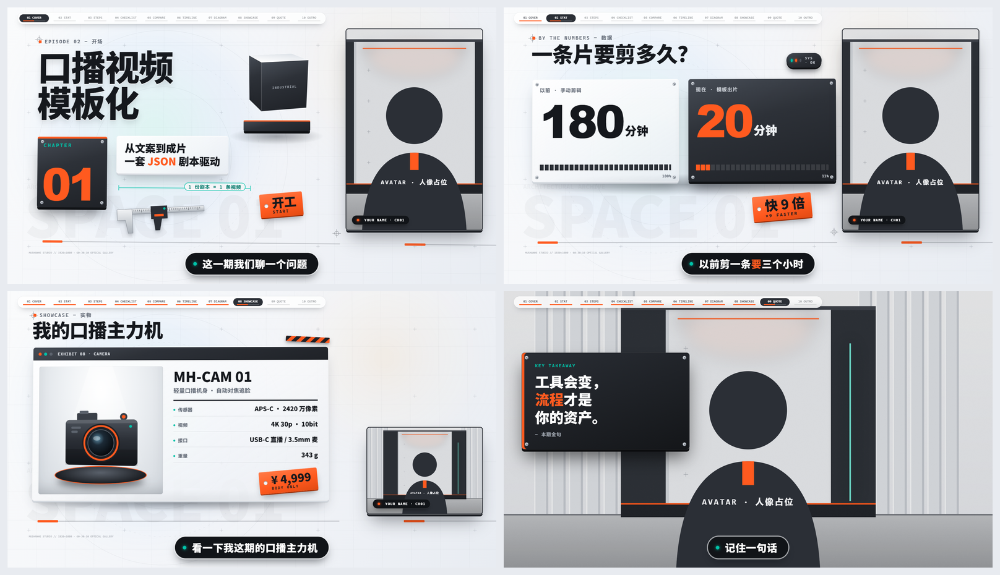
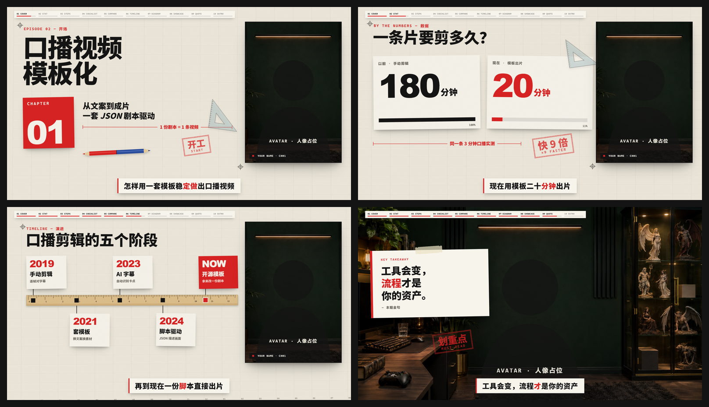
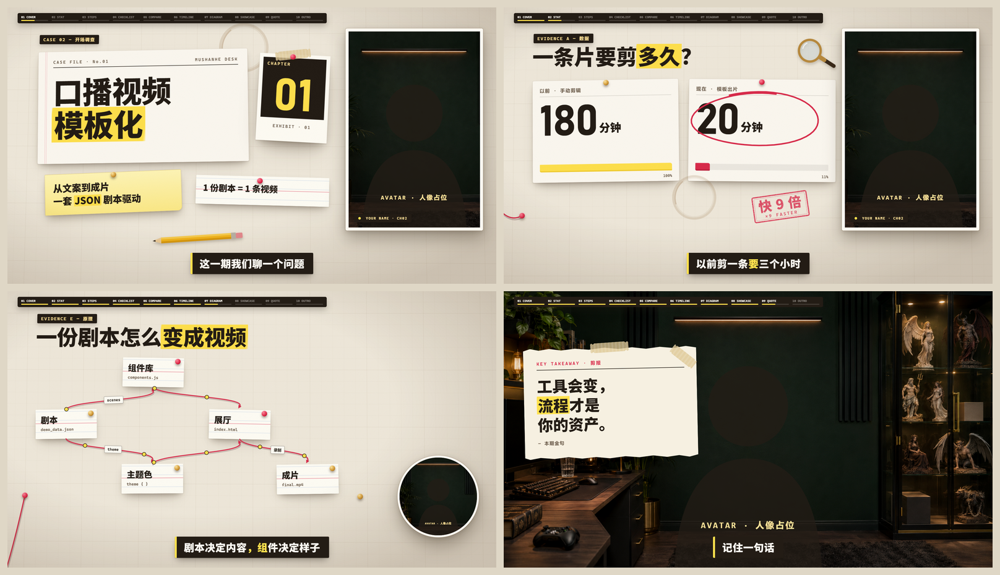
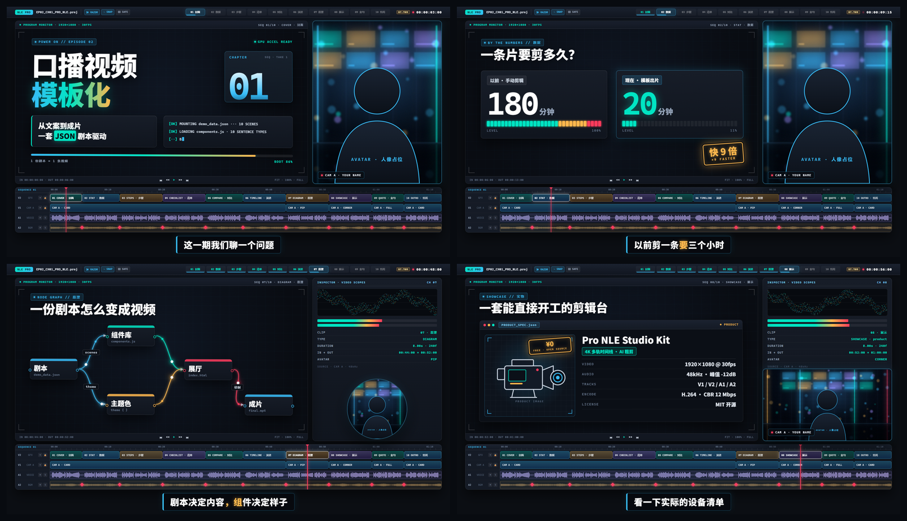
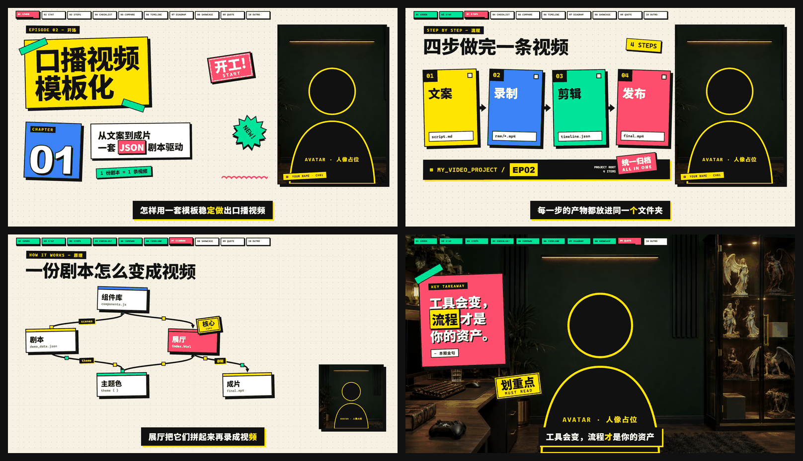
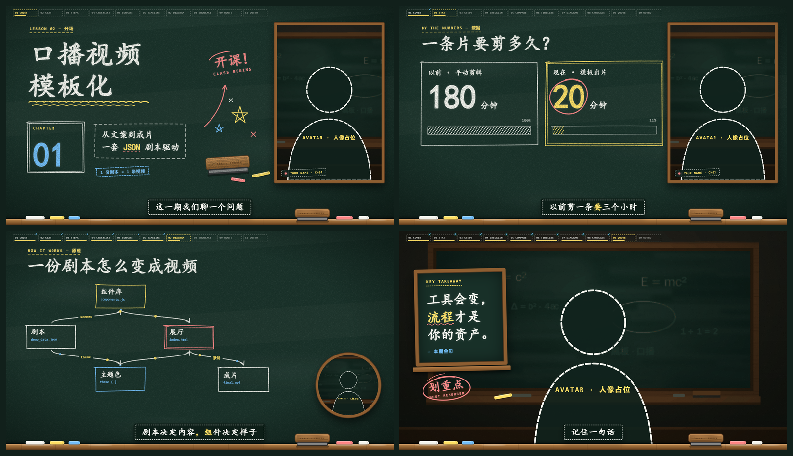
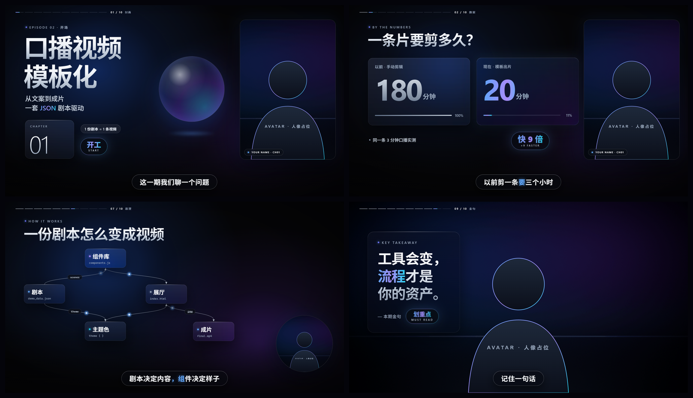
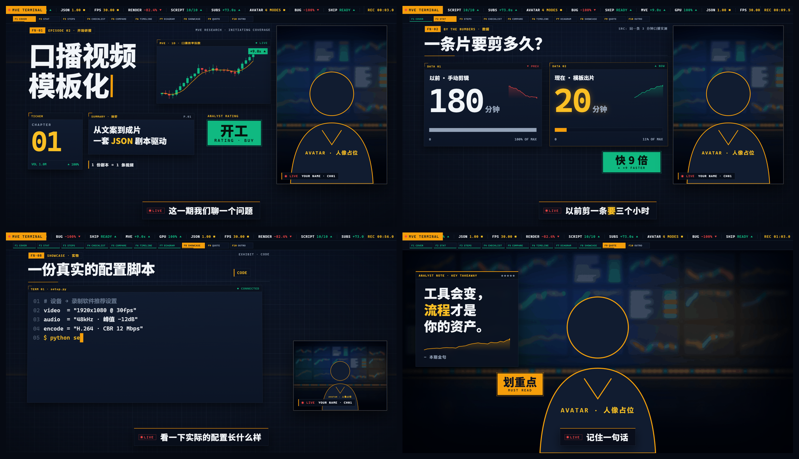

<div align="center">

### [🚀 Live Demo (all 12 styles, no download)](https://mushanhe.github.io/Mushanhe_Video_Engine/)

# Mushanhe Video Engine

[简体中文](README.md) | **English**

**One JSON script drives 12 cinematic styles × 30 ready-made skins.**

1 shared `core/` kernel · 10 universal talking-head scene types · 4 animated avatar modes with particle morphs · **4 live skins each for 01–06 (24) + 6 new styles 07–12**

`v3.2.1` · plain HTML / CSS / JS · zero build · seek to any moment and get the exact frame · one-click 01–12 style switcher (top-right) · one-click 1080p / 4K MP4 export · bilingual AI Agent Skill included (`SKILL.md` / `SKILL.en.md`)

| 01 · 3D Industrial Gallery | 02 · Swiss Print Collage |
|---|---|
| <a href="https://mushanhe.github.io/Mushanhe_Video_Engine/templates/01_industrial_3d/index.html"></a><br />[▶ Open 01 online](https://mushanhe.github.io/Mushanhe_Video_Engine/templates/01_industrial_3d/index.html) | <a href="https://mushanhe.github.io/Mushanhe_Video_Engine/templates/02_swiss_print/index.html"></a><br />[▶ Open 02 online](https://mushanhe.github.io/Mushanhe_Video_Engine/templates/02_swiss_print/index.html) |

| 03 · Vox Detective Desk | 04 · ComfyUI 3D Node Graph |
|---|---|
| <a href="https://mushanhe.github.io/Mushanhe_Video_Engine/templates/03_vox_desk/index.html"></a><br />[▶ Open 03 online](https://mushanhe.github.io/Mushanhe_Video_Engine/templates/03_vox_desk/index.html) | <a href="https://mushanhe.github.io/Mushanhe_Video_Engine/templates/04_nodegraph/index.html"></a><br />[▶ Open 04 online](https://mushanhe.github.io/Mushanhe_Video_Engine/templates/04_nodegraph/index.html) |

| 05 · Pro NLE Multitrack Editor | 06 · Neo-Brutalism Clash Zine |
|---|---|
| <a href="https://mushanhe.github.io/Mushanhe_Video_Engine/templates/05_pro_nle/index.html"></a><br />[▶ Open 05 online](https://mushanhe.github.io/Mushanhe_Video_Engine/templates/05_pro_nle/index.html) | <a href="https://mushanhe.github.io/Mushanhe_Video_Engine/templates/06_neobrutalism/index.html"></a><br />[▶ Open 06 online](https://mushanhe.github.io/Mushanhe_Video_Engine/templates/06_neobrutalism/index.html) |

| 07 · Academy Chalkboard | 08 · Song-Dynasty Ink |
|---|---|
| <a href="https://mushanhe.github.io/Mushanhe_Video_Engine/templates/07_chalkboard/index.html"></a><br />[▶ Open 07 online 🆕](https://mushanhe.github.io/Mushanhe_Video_Engine/templates/07_chalkboard/index.html) | <a href="https://mushanhe.github.io/Mushanhe_Video_Engine/templates/08_song_ink/index.html"></a><br />[▶ Open 08 online 🆕](https://mushanhe.github.io/Mushanhe_Video_Engine/templates/08_song_ink/index.html) |

| 09 · Japanese Film Magazine | 10 · Retro CRT Pixel Terminal |
|---|---|
| <a href="https://mushanhe.github.io/Mushanhe_Video_Engine/templates/09_analog_film/index.html"></a><br />[▶ Open 09 online 🆕](https://mushanhe.github.io/Mushanhe_Video_Engine/templates/09_analog_film/index.html) | <a href="https://mushanhe.github.io/Mushanhe_Video_Engine/templates/10_retro_crt/index.html"></a><br />[▶ Open 10 online 🆕](https://mushanhe.github.io/Mushanhe_Video_Engine/templates/10_retro_crt/index.html) |

| 11 · Keynote Dark Glow | 12 · Wall Street Finance Terminal |
|---|---|
| <a href="https://mushanhe.github.io/Mushanhe_Video_Engine/templates/11_keynote_glass/index.html"></a><br />[▶ Open 11 online 🆕](https://mushanhe.github.io/Mushanhe_Video_Engine/templates/11_keynote_glass/index.html) | <a href="https://mushanhe.github.io/Mushanhe_Video_Engine/templates/12_bloomberg_fin/index.html"></a><br />[▶ Open 12 online 🆕](https://mushanhe.github.io/Mushanhe_Video_Engine/templates/12_bloomberg_fin/index.html) |

</div>

---

## What it is

Mushanhe Video Engine splits a talking-head video into two layers:

- **Content**: written in one `{ meta, theme, scenes }` JSON script that only says "what this scene says, and which scene type it uses".
- **Look**: handled by a style pack. Swap the style pack and the whole art direction changes, without touching a single word of the script.

Every frame is rendered deterministically in time: scrub to second 37.4 and you always get exactly what second 37.4 should look like. That makes frame-by-frame inspection and headless rendering possible.

## Highlights

| | |
|---|---|
| 🧱 **Shared kernel `core/`** | 6-DoF 3D camera (push / pull / pan / tilt + handheld feel), word-level karaoke subtitles, avatar mode controller, dot-matrix particle scatter/gather transitions, headless frame-inspection script |
| 📜 **One script standard** | A single `{ meta, theme, scenes }` format works across all 12 style packs; `theme` only changes color variables, `scenes[].data` only holds copy |
| 🗂 **10 universal scene types** | Cover the most common segment types in knowledge / tech / gadget / tool talking-head videos |
| 🧑 **4 avatar modes** | `card` side frame · `pip` round/square picture-in-picture · `corner` small corner window · `full` full-screen presenter, with particle scatter/gather transitions between modes |
| 🎨 **12 flagship styles (v3.0)** | 3D Industrial Gallery · Swiss Print Collage · Vox Detective Desk · ComfyUI 3D Node Graph · Pro NLE Multitrack Editor · Neo-Brutalism Clash Zine · **Academy Chalkboard · Song-Dynasty Ink · Japanese Film · Retro CRT · Keynote Dark Glow · Wall Street Finance Terminal** |
| 🌗 **30 ready-made skins** | 01–06 each ship 4 light/dark live skins (24), switched with one click on the top-right capsule, or via `?theme=` / script `theme.preset`; 07–12 each have 1 standalone style art direction (6) |
| 🎛 **One-click 01–12 style switching (v3.2)** | Every preview page has a "🎨 Switch style" capsule in the top-right: jump to any style with one click, **carrying the current `?data=` script** (path auto-rebased) and the current playback time; hides with `H`, never appears during frame inspection / export |
| 🎬 **One-click MP4 export (v3.2)** | `core/tools/export_mp4.py`: deterministic per-frame headless screenshots → multi-process chunked FFmpeg encoding, 1080p / 4K (2× vector rendering), BT.709 color, voice / BGM mixing |
| 🎙 **Real word-level timeline (v3.2)** | Optional script fields: `sc.words` word timestamps (subtitles light up at real speaking pace), `sc.avatarCues` avatar changes within a scene, `meta.audio` voice track as master clock, `meta.themeCues` timed skin changes; without these fields output is frame-identical to earlier versions |
| 🤖 **AI Agent Skill** | Root `SKILL.md` (Chinese) / `SKILL.en.md` (English): after reading it, Claude Code / Antigravity / Cursor can recommend the best-fitting of the 12 styles, write the script, inspect frames and deliver a preview |

### 10 universal scene types

| Type | Talking-head use |
|---|---|
| `cover` Cover | Opening title, chapter number |
| `stat` Big number | Number hooks like "from 3 hours down to 20 minutes", rolling number + ratio bar |
| `steps` Steps | 3–5 step procedure |
| `checklist` Checklist | Rules / key points ticked one by one |
| `compare` Compare | Wrong way vs right way |
| `timeline` Timeline | Version history, stages, "you are here" highlight; camera tracks sideways when there are many nodes |
| `diagram` Diagram | Principle / architecture / workflow: nodes + links + flowing pulses |
| `showcase` Showcase | Code, terminal, documents, screenshots, screen recordings, plus `kind: "product"` for physical devices / tools |
| `quote` Quote | Full-screen avatar + side quote card that automatically avoids the face |
| `outro` Outro | Call to action + follow / open-source CTA |

### 12 flagship style packs

| Style pack | Art keywords | Try online |
|---|---|---|
| [`templates/01_industrial_3d/`](templates/01_industrial_3d/) | Pearl-white optical gallery · brushed-metal slabs · thick frosted glass · 3D cube / vernier caliper / spotlit camera display case · gallery walk-through glass-partition transitions | [▶ 01](https://mushanhe.github.io/Mushanhe_Video_Engine/templates/01_industrial_3d/index.html) |
| [`templates/02_swiss_print/`](templates/02_swiss_print/) | Off-white grid paper · Swiss red · ink black · square-cut paper with light shadows · wooden ruler / pencil / set-square props · full-page paper-pull transitions | [▶ 02](https://mushanhe.github.io/Mushanhe_Video_Engine/templates/02_swiss_print/index.html) |
| [`templates/03_vox_desk/`](templates/03_vox_desk/) | Warm linen cutting mat · yellow highlighter · hand-drawn red circles / ticks / crosses · red investigation string · torn clippings · overhead diagonal fly-over transitions | [▶ 03](https://mushanhe.github.io/Mushanhe_Video_Engine/templates/03_vox_desk/index.html) |
| [`templates/04_nodegraph/`](templates/04_nodegraph/) | Deep-space blue-black grid · glowing Bézier signal wires and pulse dots · oscilloscope / ring pass-rate gauge / laser wireframe display case · neon light-curtain transitions | [▶ 04](https://mushanhe.github.io/Mushanhe_Video_Engine/templates/04_nodegraph/index.html) |
| [`templates/05_pro_nle/`](templates/05_pro_nle/) | Futuristic multitrack NLE · real 4-track timeline with per-character waveform · smart-fill Lumetri scopes on the right · four-color bars clapper transitions | [▶ 05](https://mushanhe.github.io/Mushanhe_Video_Engine/templates/05_pro_nle/index.html) |
| [`templates/06_neobrutalism/`](templates/06_neobrutalism/) | Warm beige breathing polka dots · 4px thick black borders · 8 / 12px hard shadows · yellow / electric blue / mint / coral clash colors · four-color block sweep transitions | [▶ 06](https://mushanhe.github.io/Mushanhe_Video_Engine/templates/06_neobrutalism/index.html) |
| [`templates/07_chalkboard/`](templates/07_chalkboard/) 🆕 | Dark-green matte chalkboard · chalk white / yellow / sky blue / coral pink · seeded hand-drawn jittery frames · stroke-by-stroke circles, ticks and arrows · wooden eraser and colored chalk sticks | [▶ 07](https://mushanhe.github.io/Mushanhe_Video_Engine/templates/07_chalkboard/index.html) |
| [`templates/08_song_ink/`](templates/08_song_ink/) 🆕 | Rice paper · Hui ink · cinnabar · azurite · 1px fine double ink frame + fret-pattern corners · cinnabar square seal · dry-brush strokes · vertical headings · moon-gate avatar window | [▶ 08](https://mushanhe.github.io/Mushanhe_Video_Engine/templates/08_song_ink/index.html) |
| [`templates/09_analog_film/`](templates/09_analog_film/) 🆕 | Cream magazine paper · Polaroid borders · 35mm sprocket film strip · glowing orange date stamp · instant-film developing animation · marker-pen annotations | [▶ 09](https://mushanhe.github.io/Mushanhe_Video_Engine/templates/09_analog_film/index.html) |
| [`templates/10_retro_crt/`](templates/10_retro_crt/) 🆕 | Pure black with green tint · phosphor-green glow + scanlines · double-line ASCII window frames · pixel-block progress bars · typewriter text · CRT window-open flicker | [▶ 10](https://mushanhe.github.io/Mushanhe_Video_Engine/templates/10_retro_crt/index.html) |
| [`templates/11_keynote_glass/`](templates/11_keynote_glass/) 🆕 | Pure-black stage · 1px bright-edge liquid frosted-glass Bento · oversized titanium gradient headings · blue-violet-cyan aurora accents · soft depth-of-field entrances | [▶ 11](https://mushanhe.github.io/Mushanhe_Video_Engine/templates/11_keynote_glass/index.html) |
| [`templates/12_bloomberg_fin/`](templates/12_bloomberg_fin/) 🆕 | Deep navy terminal panels · amber function keys · monospaced tabular numbers · deterministic candlesticks / sparklines · scrolling ticker · rating badges, green up / red down | [▶ 12](https://mushanhe.github.io/Mushanhe_Video_Engine/templates/12_bloomberg_fin/index.html) |

### 30 ready-made skins (v3.0)

**01–06**: each style pack has its own `themes.js` with 4 built-in skins (the first is the default; opening without parameters looks exactly like v2.0). Every skin was checked with headless frame captures for contrast of text, cards, subtitles and avatar borders (no black text on dark skins, no white text on light skins).

| Style pack | `?theme=` skins |
|---|---|
| 01 · 3D Industrial Gallery | `pearl` · `obsidian` · `tactical` · `concrete` |
| 02 · Swiss Print Collage | `classic` Swiss red · `bauhaus` · `midnight` · `botanical` |
| 03 · Vox Detective Desk | `linen` · `night_desk` · `blueprint` · `newsprint` |
| 04 · ComfyUI 3D Node Graph | `cyber` · `matrix` · `amber_lab` · `daylight` |
| 05 · Pro NLE Multitrack Editor | `premiere` · `davinci` · `fcp_silver` · `broadcast` |
| 06 · Neo-Brutalism Clash Zine | `zine` · `acid` · `pop_pink` · `mono_ink` |
| 07–12 · six new styles | 1 standalone art direction each (chalkboard / ink / film / CRT / Keynote / finance terminal); fine-tune via color variables in `theme` |

Three ways to switch skins on 01–06, highest priority first:

1. URL parameter: `templates/02_swiss_print/index.html?theme=midnight`
2. In the script: `"theme": { "preset": "midnight" }`
3. The skin capsule in the top-right of the preview page: one click switches and syncs the URL; it hides together with the HUD when you press `H`.

`01_industrial_3d` also has 4 layout variants, enabled with `"variant"` on a scene: `cover` → `blueprint` · `stat` → `gauge` · `steps` → `conveyor` · `compare` → `split`; sample script `templates/01_industrial_3d/demo_variants.json`.

## Local preview in 3 steps

Don't want to download? Just open the [Live Demo](https://mushanhe.github.io/Mushanhe_Video_Engine/). To edit scripts locally you need Python 3.8+, with no extra dependencies:

```bash
# 1. Clone the repository
git clone https://github.com/mushanhe/Mushanhe_Video_Engine.git
cd Mushanhe_Video_Engine

# 2. Start the local preview server (default 127.0.0.1:8765, supports HTTP 206 range requests)
python core/tools/serve.py

# 3. Open the index page in a browser and click into any style pack
#    http://127.0.0.1:8765/
```

Preview shortcuts: `Space` play / pause · `1`–`9` / `0` jump to scene 1–10 · `H` hide controls (the top-right switcher hides too).

Want another style? Click "🎨 Switch style 01–12" in the top-right to jump between all 12; a script loaded via `?data=` comes along automatically. For example, switching to 02 from `01_industrial_3d/index.html?data=my_script.json` opens `02_swiss_print/index.html?data=../01_industrial_3d/my_script.json`.

> Script JSON is loaded with `fetch`, so open pages through the local server above; double-clicking the HTML file shows a load error.

## Write your own script

Copy `demo_data.json` from any style pack, edit it, and load it with `?data=`:

```
http://127.0.0.1:8765/templates/05_pro_nle/index.html?data=my_script.json
```

Script structure (excerpt):

```json
{
  "meta":  { "title": "My first video", "avatar": { "video": "", "bg": "assets/studio_bg.png", "tag": "YOUR NAME" } },
  "theme": { "yellow": "#FFE500", "coral": "#FF4D6D" },
  "scenes": [
    { "type": "cover", "dur": 6, "avatar": "card",
      "sub": ["Today let's talk about one question"],
      "data": { "kicker": "EPISODE 01", "title": "Talking-head\nas templates", "subtitle": "Driven by one **JSON** script" } },
    { "type": "stat", "dur": 7, "avatar": "pip",
      "sub": ["Editing one video used to take three hours"],
      "data": { "title": "How long does one video take?",
        "items": [ { "value": 180, "unit": "min", "label": "Before", "bar": 1 },
                   { "value": 20,  "unit": "min", "label": "Now", "bar": 0.11 } ],
        "delta": "9× faster" } }
  ]
}
```

- `sub[]`: this scene's subtitle lines, automatically laid out with word-by-word highlighting.
- `avatar`: `card` / `pip` / `corner` / `full`.
- `**keyword**`: marks the accent color in titles and subtitles.
- `meta.avatar.video`: set it to your keyed (alpha) presenter video to replace the silhouette placeholder.

### Real-footage sync fields (v3.2, optional)

All times are **absolute seconds on the whole-video timeline** (counted from the start of scene 1, not relative to the scene); without these fields output is frame-identical to the original.

| Field | Format | Effect |
|---|---|---|
| `sc.words` | `[["word", absStart, absEnd], ...]` | Real word-level subtitle highlighting; if omitted, falls back to spreading `sub[]` evenly (scene-relative seconds passed by mistake are shifted by the scene start automatically, with a `console.warn`) |
| `sc.avatarCues` | `[[absSec, "card\|pip\|corner\|full"], ...]` | Switch avatar mode within a scene |
| `meta.audio` | `"voice.wav"` or `{ "src": "...", "offset": 0, "volume": 1 }` | Voice track, used as the master clock during playback |
| `meta.themeCues` | `[[absSec, "obsidian", "badge text"], ...]` | Timed live skin changes (01–06) |

> ⚠️ **The avatar `<video>` is muted by default**: none of the 12 templates use the presenter video's own audio track. Supply the voice with `meta.audio` or `--audio` at export, otherwise the final video is silent.

For the full fields of every scene type, look at `demo_data.json` in any style pack — all 10 scenes have examples.

## Use it as an AI Agent Skill

[`SKILL.md`](SKILL.md) (Chinese) and [`SKILL.en.md`](SKILL.en.md) (English) in the repo root are a standard Agent Skill: the 12-style + 30-skin index, a 10-scene-type cheat sheet, the script schema, the 5-step production workflow (including one-click MP4 export) and the "check for updates" rule are all inside. Hand the repo to an AI coding assistant and just describe what you want in plain language.

**Claude Code**: copy `SKILL.en.md` to `~/.claude/skills/mushanhe-video-engine/SKILL.md` (global) or `.claude/skills/mushanhe-video-engine/SKILL.md` inside the repo (rename it to `SKILL.md`); it is then invoked automatically whenever you ask for a talking-head video. For a one-off, just say "read SKILL.en.md in the repo root first".

**Antigravity / Cursor**: open the repo folder and say "read SKILL.en.md in the repo root first, then follow its workflow", or add it to your project rules.

Then just ask, for example:

> Turn the script below into a video. It's a tech review, use the obsidian skin of Industrial 3D.
>
> This script is about AI workflows — recommend a style and skin, and give me a preview link when done.
>
> Redo the last one in Swiss Print with the bauhaus skin.
>
> This is a reading video about Song-dynasty poetry; pick the style that fits best.

The AI follows 5 steps: ① confirm or recommend a style and skin → ② write the voice-over as a `{ meta, theme, scenes }` script → ③ run `inspect_frames.py`, confirm `ZERO_ERRORS` and check every screenshot → ④ start `serve.py` and deliver a preview link → ⑤ after approval, export with `export_mp4.py`. The same script can switch to any of the other 11 styles at any time, and 01–06 can also switch to their other 3 skins.

## Headless frame inspection

After changing visuals, capture screenshots at any time points to self-check (requires `pip install playwright` and `playwright install chromium`):

```bash
python core/tools/inspect_frames.py --template 01_industrial_3d --times 3,9.5,17,25,32.5,40,48,56,63,69.5 --out preview_frames
```

To check a non-default skin or your own script, add `--theme` / `--data` (script path relative to the style-pack folder; it is assembled into `?data=..&theme=..&t=..&clean=1` automatically):

```bash
python core/tools/inspect_frames.py --template 01_industrial_3d --data demo_variants.json --theme obsidian --times 3,9.5 --out scratch_verify/my_ep
```

`ZERO_ERRORS` means the page threw no errors; screenshots go to the `--out` folder.

## One-click MP4 export (1080p / 4K)

Requirements: `pip install playwright` (uses installed Edge / Chrome if present, otherwise also run `playwright install chromium`) + [FFmpeg](https://ffmpeg.org/download.html) on PATH.

```bash
# Default demo of one template (duration read from the script length)
python core/tools/export_mp4.py --template 01_industrial_3d --theme obsidian --out output/demo_obsidian.mp4

# Your own script + voice track (--audio can be omitted if the script has meta.audio)
python core/tools/export_mp4.py --template 05_pro_nle --data my_script.json --theme davinci --audio my_voice.wav --out output/my_ep.mp4

# 4K: the same 1920×1080 layout rendered as vectors at 2× device pixel ratio into 3840×2160, zero coordinate offset
python core/tools/export_mp4.py --template 08_song_ink --data my_script.json --res 4k --out output/my_ep_4k.mp4
```

| Option | Description |
|---|---|
| `--template` / `--file` / `--url-path` / `--data` / `--theme` | Same page entry points as `inspect_frames.py`, with `clean=1` added automatically (no HUD or switcher) |
| `--res 1080p\|4k` · `--fps 30` | Output 1920×1080 or 3840×2160, H.264 High · yuv420p · BT.709 |
| `--start` / `--duration` | Export only a slice (great for smoke tests); without a duration it reads the page's `__MH_ENGINE__.duration` |
| `--workers 4` · `--crf` · `--preset` | Multi-process chunked rendering; CRF defaults to 18 at 1080p and 16 at 4K |
| `--audio` · `--bgm` · `--bgm-vol 0.10` | Precisely mix an external voice / master (defaults to the script's `meta.audio`), optional looping BGM; AAC 48 kHz 320 kbps |

**Expected time**: local headless frame-by-frame rendering takes about 3–10× real time at 1080p (depending on machine and assets), longer at 4K. At start it prints total frames, worker count and estimated minutes, then progress and ETA every 5s. Smoke-test with `--duration 3` first to confirm picture and sound, then export the full video.

How it works: for each frame `seek(t)` → wait for the avatar video to decode → wait 2 `requestAnimationFrame` ticks → pipe the PNG screenshot straight into FFmpeg (nothing written to disk), then losslessly concatenate the chunks and mux the audio. `ZERO_ERRORS` at the end means no page errors during the whole run.

## Getting new styles and updates

New styles, skins and tools keep landing on `main`. In the repo root:

```bash
git fetch origin main && git status -sb      # "behind N" means a new version is available
git log --oneline HEAD..origin/main          # see what changed
git pull --ff-only                           # fast-forward update (no merge, never overwrites your local files)
```

Save your own scripts as new files (e.g. `my_script.json`) so updates never overwrite them; if you edited files from the repo and the pull reports a conflict, `git stash` first, then update.
With an AI coding assistant, just say "check whether the templates have updates" — `SKILL.md` / `SKILL.en.md` describe the check → notify → `git pull --ff-only` after confirmation flow.

## Directory structure

```text
Mushanhe_Video_Engine/
├── index.html                 # Index page: 12 style poster cards · skin dots for 01–06
├── README.en.md               # English README
├── SKILL.md                   # AI Agent Skill (Chinese): pick style → write script → inspect → deliver
├── SKILL.en.md                # AI Agent Skill (English)
├── docs/                      # 2×2 preview collages for the 12 style packs (1616×930)
├── core/                      # Shared kernel (used by every style pack)
│   ├── camera-rig.js          # 6-DoF 3D camera
│   ├── avatar.js              # Avatar mode controller
│   ├── avatar-morph-fx.js     # Dot-matrix particle scatter/gather transitions
│   ├── subtitle.js            # Word-level karaoke subtitles
│   ├── timeline.js            # Word-level timeline
│   ├── script-sync.js         # Real word timings / voice master clock / timed skins · top-right 01–12 style switcher
│   ├── engine.css             # 1920×1080 canvas, layers, HUD
│   ├── …                      # 3D modules, gallery backgrounds, foreground FX, live cursors, foley and other extensions
│   ├── vendor/                # Third-party libraries: GSAP, CustomEase, three.js
│   └── tools/                 # serve.py preview server · inspect_frames.py frame inspection · export_mp4.py MP4 export
└── templates/
    ├── 01_industrial_3d/      # Flagship #1 · 3D Industrial Gallery
    ├── 02_swiss_print/        # Flagship #2 · Swiss Print Collage
    ├── 03_vox_desk/           # Flagship #3 · Vox Detective Desk
    ├── 04_nodegraph/          # Flagship #4 · ComfyUI 3D Node Graph
    ├── 05_pro_nle/            # Flagship #5 · Pro NLE Multitrack Editor
    ├── 06_neobrutalism/       # Flagship #6 · Neo-Brutalism Clash Zine
    ├── 07_chalkboard/         # Flagship #7 · Academy Chalkboard (v3.0)
    ├── 08_song_ink/           # Flagship #8 · Song-Dynasty Ink (v3.0)
    ├── 09_analog_film/        # Flagship #9 · Japanese Film Magazine (v3.0)
    ├── 10_retro_crt/          # Flagship #10 · Retro CRT Pixel Terminal (v3.0)
    ├── 11_keynote_glass/      # Flagship #11 · Keynote Dark Glow (v3.0)
    └── 12_bloomberg_fin/      # Flagship #12 · Wall Street Finance Terminal (v3.0)
        ├── components.js      # 10 scene-type components
        ├── themes.js          # 4 live skins (01–06 only)
        ├── demo_data.json     # 10-scene sample script
        ├── index.html         # Preview page / render host
        └── assets/            # Studio background
```

## Build a new style pack

Create a folder under `templates/`, implement the same 10 scene types, and give every component the same signature:

```js
create(data, { dur }) → { el, layer, avatar, cams, update(localT), w? }
```

- `el`: the component's root node; `layer`: `world` (follows the 3D camera) or `screen` (pinned to the screen).
- `cams`: camera keyframes for this scene; `update(localT)`: renders at this scene's local time and must be deterministic.
- Keep data fields identical to the existing 12 flagship packs, so any script can switch seamlessly between all style packs.

## Roadmap

- [x] **v1.0**: shared `core/` kernel + 10 scene types + 4 avatar particle morphs + 2 flagship packs
- [x] **v2.0**: all 6 flagship styles open-sourced (Industrial 3D / Swiss Print / Vox Detective / ComfyUI Nodes / Pro NLE / Clash Zine)
- [x] **v2.5**: 4 live skins per pack for 6 packs (24 total) + 4 `variant` layouts for 01 Industrial 3D + unified `SKILL.md` Agent Skill
- [x] **v3.0**: 12 flagship styles (new: Chalkboard / Song Ink / Japanese Film / Retro CRT / Keynote Dark Glow / Finance Terminal) + 30 skins + 12 2×2 preview collages + `SKILL.md` equal-rank index of all 12
- [x] **v3.1**: `inspect_frames.py` supports `--data` / `--theme` to check any skin and custom script in one command; leaner `SKILL.md` so lightweight agents can use it directly
- [x] **v3.2**: `export_mp4.py` one-click 1080p / 4K MP4 export (multi-process chunks + BT.709 + audio mixing) · top-right 01–12 style switcher on all 12 pages (carries the `?data=` script) · `script-sync.js` real word-level subtitles / voice master clock / timed skins · `SKILL.md` adds export and auto update check
- [x] **v3.2.1**: `sc.words` passed in scene-relative seconds is auto-corrected with a warning · `export_mp4.py` prints an expected-time hint at start · bilingual `README` / `SKILL` (`README.en.md` · `SKILL.en.md`) · documented the 4 sync fields and the muted-avatar reminder
- [ ] **Live skins for 07–12**: 4 `themes.js` live skins for each of the six new styles
- [ ] **More variants and vertical components**: `variant` layouts for the other packs + vertical components (finance / programming / reading)
- [ ] Automatic BGM ducking (lower background music under speech)
- [ ] Visual script editor

👉 Tell us which new styles or scene types you want in [Issues](https://github.com/mushanhe/Mushanhe_Video_Engine/issues)!

## Third-party components

`core/vendor/` bundles the following third-party libraries so everything works offline out of the box (including on networks in mainland China). Their copyright belongs to their respective authors and they are **not covered by this repository's MIT license**; follow their own licenses:

- [GSAP](https://gsap.com) and CustomEase (GreenSock): [GSAP Standard License](https://gsap.com/standard-license) — free and usable commercially, but not an open-source license
- [three.js](https://threejs.org): MIT License

## License

The original code and assets of this repository (`core/`, all 12 style packs `templates/01_industrial_3d/` ~ `templates/12_bloomberg_fin/`, including the studio background `studio_bg.png` and the `docs/` preview collages) are released under the [MIT License](LICENSE), © 2026 mushanhe. Third-party libraries in `core/vendor/` are excluded; see the section above.

Fonts: the templates use system sans-serif / serif font stacks so they open instantly offline. For commercial releases, make sure the system fonts you use are licensed for commercial use, or replace them with open-source fonts (e.g. Source Han Sans / Source Han Serif).
