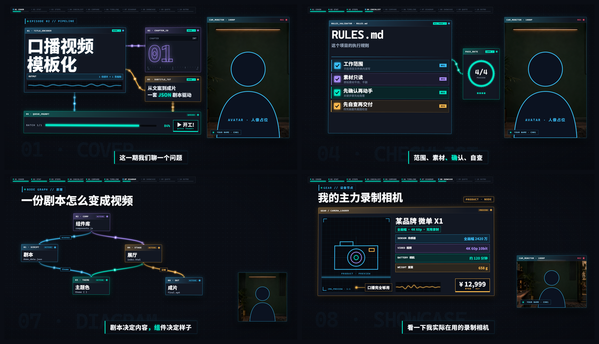
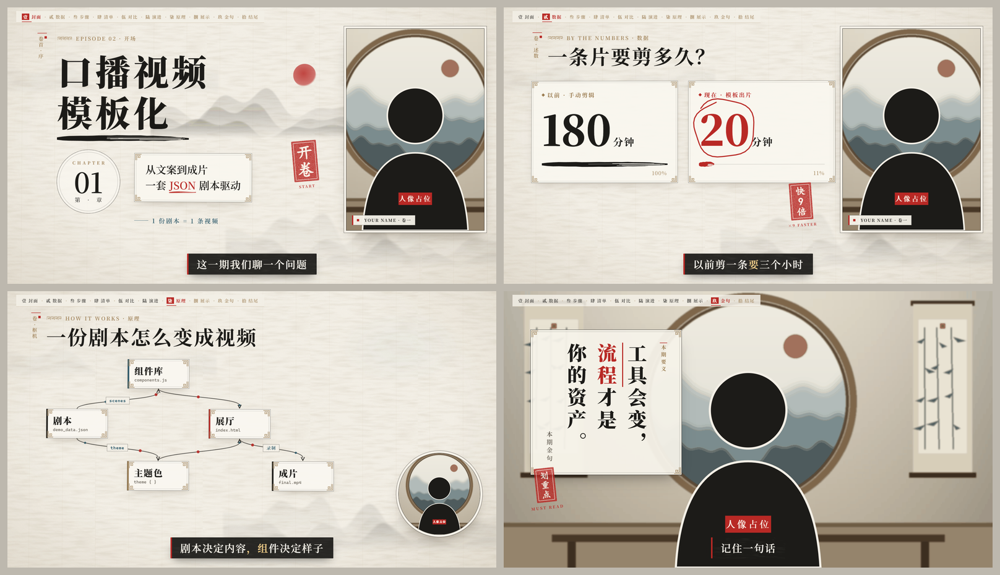
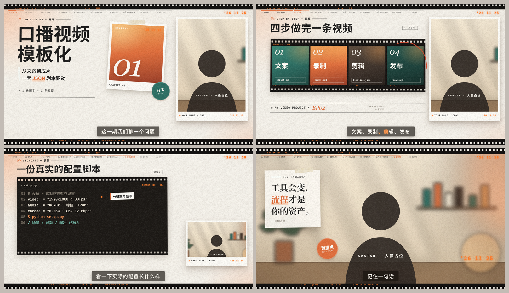
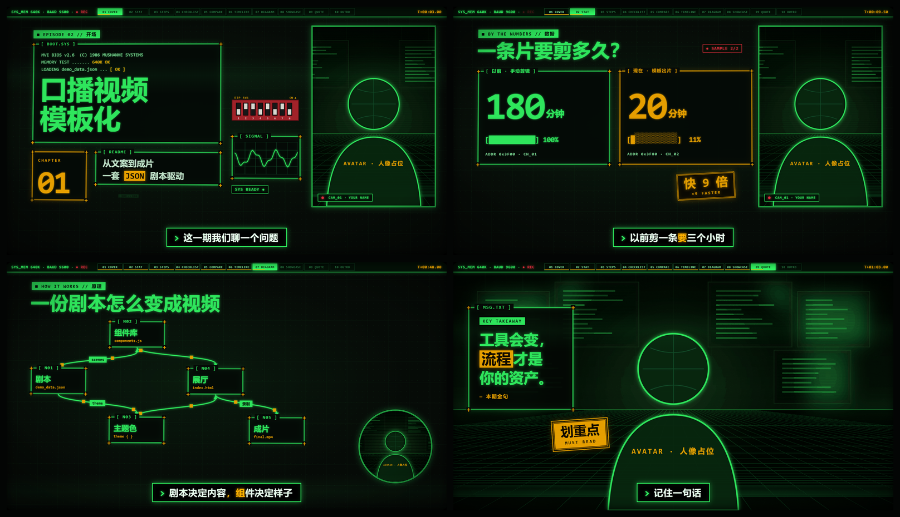

<div align="center">

### [🚀 Live Demo (all 12 styles, no download)](https://mushanhe.github.io/Mushanhe_Video_Engine/)

# Mushanhe Video Engine

[简体中文](README.md) | **English**

**One JSON script drives 12 cinematic styles × 30 ready-made skins.**

1 shared `core/` kernel · 10 universal talking-head scene types · 4 animated avatar modes with particle morphs · **4 live skins each for 01–06 (24) + 6 new styles 07–12**

`v3.5` · plain HTML / CSS / JS · zero build · seek to any moment and get the exact frame · one-click 01–12 style switcher (top-right) · one-click 1080p / 4K MP4 export · bilingual AI Agent Skill included (`SKILL.md` / `SKILL.en.md`)

| 01 · 3D Industrial Gallery | 02 · Swiss Print Collage |
|---|---|
| <a href="https://mushanhe.github.io/Mushanhe_Video_Engine/templates/01_industrial_3d/index.html"></a><br />[▶ Open 01 online](https://mushanhe.github.io/Mushanhe_Video_Engine/templates/01_industrial_3d/index.html) | <a href="https://mushanhe.github.io/Mushanhe_Video_Engine/templates/02_swiss_print/index.html"></a><br />[▶ Open 02 online](https://mushanhe.github.io/Mushanhe_Video_Engine/templates/02_swiss_print/index.html) |

| 03 · Investigative Desk | 04 · 3D Node Graph |
|---|---|
| <a href="https://mushanhe.github.io/Mushanhe_Video_Engine/templates/03_investigative_desk/index.html"></a><br />[▶ Open 03 online](https://mushanhe.github.io/Mushanhe_Video_Engine/templates/03_investigative_desk/index.html) | <a href="https://mushanhe.github.io/Mushanhe_Video_Engine/templates/04_nodegraph/index.html"></a><br />[▶ Open 04 online](https://mushanhe.github.io/Mushanhe_Video_Engine/templates/04_nodegraph/index.html) |

| 05 · Pro NLE Multitrack Editor | 06 · Neo-Brutalism Clash Zine |
|---|---|
| <a href="https://mushanhe.github.io/Mushanhe_Video_Engine/templates/05_pro_nle/index.html"></a><br />[▶ Open 05 online](https://mushanhe.github.io/Mushanhe_Video_Engine/templates/05_pro_nle/index.html) | <a href="https://mushanhe.github.io/Mushanhe_Video_Engine/templates/06_neobrutalism/index.html"></a><br />[▶ Open 06 online](https://mushanhe.github.io/Mushanhe_Video_Engine/templates/06_neobrutalism/index.html) |

| 07 · Academy Chalkboard | 08 · Song-Dynasty Ink |
|---|---|
| <a href="https://mushanhe.github.io/Mushanhe_Video_Engine/templates/07_chalkboard/index.html"></a><br />[▶ Open 07 online 🆕](https://mushanhe.github.io/Mushanhe_Video_Engine/templates/07_chalkboard/index.html) | <a href="https://mushanhe.github.io/Mushanhe_Video_Engine/templates/08_song_ink/index.html"></a><br />[▶ Open 08 online 🆕](https://mushanhe.github.io/Mushanhe_Video_Engine/templates/08_song_ink/index.html) |

| 09 · Japanese Film Magazine | 10 · Retro CRT Pixel Terminal |
|---|---|
| <a href="https://mushanhe.github.io/Mushanhe_Video_Engine/templates/09_analog_film/index.html"></a><br />[▶ Open 09 online 🆕](https://mushanhe.github.io/Mushanhe_Video_Engine/templates/09_analog_film/index.html) | <a href="https://mushanhe.github.io/Mushanhe_Video_Engine/templates/10_retro_crt/index.html"></a><br />[▶ Open 10 online 🆕](https://mushanhe.github.io/Mushanhe_Video_Engine/templates/10_retro_crt/index.html) |

| 11 · Stage Glass | 12 · Finance Data Terminal |
|---|---|
| <a href="https://mushanhe.github.io/Mushanhe_Video_Engine/templates/11_stage_glass/index.html"></a><br />[▶ Open 11 online 🆕](https://mushanhe.github.io/Mushanhe_Video_Engine/templates/11_stage_glass/index.html) | <a href="https://mushanhe.github.io/Mushanhe_Video_Engine/templates/12_fin_terminal/index.html"></a><br />[▶ Open 12 online 🆕](https://mushanhe.github.io/Mushanhe_Video_Engine/templates/12_fin_terminal/index.html) |

</div>

---

## What it is

Mushanhe Video Engine splits a talking-head video into two layers:

- **Content**: written in one `{ meta, theme, scenes }` JSON script that only says "what this scene says, and which scene type it uses".
- **Look**: handled by a style pack. Swap the style pack and the whole art direction changes, without touching a single word of the script.

Every frame is rendered deterministically in time: scrub to second 37.4 and you always get exactly what second 37.4 should look like. That makes frame-by-frame inspection and headless rendering possible.

## Highlights

| | |
|---|---|
| 🧱 **Shared kernel `core/`** | 6-DoF 3D camera (push / pull / pan / tilt + handheld feel), word-level karaoke subtitles, avatar mode controller, dot-matrix particle scatter/gather transitions, headless frame-inspection script |
| 📜 **One script standard** | A single `{ meta, theme, scenes }` format works across all 12 style packs; `theme` only changes color variables, `scenes[].data` only holds copy |
| 🗂 **10 universal scene types** | Cover the most common segment types in knowledge / tech / gadget / tool talking-head videos |
| 🧑 **4 avatar modes** | `card` side frame · `pip` round/square picture-in-picture · `corner` small corner window · `full` full-screen presenter, with particle scatter/gather transitions between modes |
| 🎨 **12 flagship styles (v3.0)** | 3D Industrial Gallery · Swiss Print Collage · Investigative Desk · 3D Node Graph · Pro NLE Multitrack Editor · Neo-Brutalism Clash Zine · **Academy Chalkboard · Song-Dynasty Ink · Japanese Film · Retro CRT · Stage Glass · Finance Data Terminal** |
| 🌗 **30 ready-made skins** | 01–06 each ship 4 light/dark live skins (24), switched with one click on the top-right capsule, or via `?theme=` / script `theme.preset`; 07–12 each have 1 standalone style art direction (6) |
| 🎛 **One-click 01–12 style switching (v3.2)** | Every preview page has a "🎨 Switch style" capsule in the top-right: jump to any style with one click, **carrying the current `?data=` script** (path auto-rebased) and the current playback time; hides with `H`, never appears during frame inspection / export |
| 🎬 **One-click MP4 export (v3.2)** | `core/tools/export_mp4.py`: deterministic per-frame headless screenshots → multi-process chunked FFmpeg encoding, 1080p / 4K (2× vector rendering), BT.709 color, voice / BGM mixing |
| 🎙 **Real word-level timeline (v3.2)** | Optional script fields: `sc.words` word timestamps (subtitles light up at real speaking pace), `sc.avatarCues` avatar changes within a scene, `meta.audio` voice track as master clock, `meta.themeCues` timed skin changes; without these fields output is frame-identical to earlier versions |
| ✂️ **Rough cut + full-screen talk scene (v3.4)** | `core/tools/rough_cut.py` trims leading/trailing silence and compresses pauses >1 s, outputs an all-intra 1080p avatar (export ~1–1.5× real time) plus a cut list; new kernel scene type `talk` (full-screen presenter + 1–2 keywords popping in as they are spoken); chart elements can enter on a spoken word via `cue`; cuts that do not land on a scene change get an automatic punch-in to hide the jump |
| 🛑 **Guard rails (v3.4)** | A scene boundary that is not at a sentence end → `align.py` fails with `STATUS FAIL cross-sentence`; missing voice / avatar / any media 404 → export fails with `STATUS FAIL missing-media` instead of a silent video; whisper hallucinations in silence are dropped; media paths resolve against the script file, so switching styles keeps every asset |
| 🗣 **One-command voice-over alignment (v3.3)** | `core/tools/align.py`: recording / video → same-source per-character `words` + subtitle `sub`, or fill each draft scene's timing and `meta.audio` directly; local faster-whisper, no PyTorch needed |
| 🤖 **AI Agent Skill** | Root `SKILL.md` (Chinese) / `SKILL.en.md` (English): after reading it, Claude Code / Antigravity / Cursor can recommend the best-fitting of the 12 styles, write the script, inspect frames and deliver a preview |

### 10 universal scene types

| Type | Talking-head use |
|---|---|
| `talk` Talk (v3.4 kernel type) | **Default for small talk / opinions / transitions**: full-screen presenter, 1–2 keywords pop in on the sides as they are spoken (outside the ±240 px centre band); works in all 12 packs |
| `cover` Cover | Opening title, chapter number |
| `stat` Big number | Number hooks like "from 3 hours down to 20 minutes", rolling number + ratio bar |
| `steps` Steps | 3–5 step procedure |
| `checklist` Checklist | Rules / key points ticked one by one |
| `compare` Compare | Wrong way vs right way |
| `timeline` Timeline | Version history, stages, "you are here" highlight; camera tracks sideways when there are many nodes |
| `diagram` Diagram | Principle / architecture / workflow: nodes + links + flowing pulses |
| `showcase` Showcase | Code, terminal, documents, screenshots, screen recordings, plus `kind: "product"` for physical devices / tools |
| `quote` Quote | Full-screen avatar + side quote card: pinned left by default (`"pos": "right"` for right), taking about 40% of the frame width on that side; the engine does not detect faces, so keep the speaker's face in the other 60% when shooting (by default: centered or right of center) |
| `outro` Outro | Call to action + follow / open-source CTA |

### 12 flagship style packs

| Style pack | Art keywords | Try online |
|---|---|---|
| [`templates/01_industrial_3d/`](templates/01_industrial_3d/) | Pearl-white optical gallery · brushed-metal slabs · thick frosted glass · 3D cube / vernier caliper / spotlit camera display case · gallery walk-through glass-partition transitions | [▶ 01](https://mushanhe.github.io/Mushanhe_Video_Engine/templates/01_industrial_3d/index.html) |
| [`templates/02_swiss_print/`](templates/02_swiss_print/) | Off-white grid paper · Swiss red · ink black · square-cut paper with light shadows · wooden ruler / pencil / set-square props · full-page paper-pull transitions | [▶ 02](https://mushanhe.github.io/Mushanhe_Video_Engine/templates/02_swiss_print/index.html) |
| [`templates/03_investigative_desk/`](templates/03_investigative_desk/) | Warm linen cutting mat · yellow highlighter · hand-drawn red circles / ticks / crosses · red investigation string · torn clippings · overhead diagonal fly-over transitions | [▶ 03](https://mushanhe.github.io/Mushanhe_Video_Engine/templates/03_investigative_desk/index.html) |
| [`templates/04_nodegraph/`](templates/04_nodegraph/) | Deep-space blue-black grid · glowing Bézier signal wires and pulse dots · oscilloscope / ring pass-rate gauge / laser wireframe display case · neon light-curtain transitions | [▶ 04](https://mushanhe.github.io/Mushanhe_Video_Engine/templates/04_nodegraph/index.html) |
| [`templates/05_pro_nle/`](templates/05_pro_nle/) | Futuristic multitrack NLE · real 4-track timeline with per-character waveform · smart-fill video scopes on the right · four-color bars clapper transitions | [▶ 05](https://mushanhe.github.io/Mushanhe_Video_Engine/templates/05_pro_nle/index.html) |
| [`templates/06_neobrutalism/`](templates/06_neobrutalism/) | Warm beige breathing polka dots · 4px thick black borders · 8 / 12px hard shadows · yellow / electric blue / mint / coral clash colors · four-color block sweep transitions | [▶ 06](https://mushanhe.github.io/Mushanhe_Video_Engine/templates/06_neobrutalism/index.html) |
| [`templates/07_chalkboard/`](templates/07_chalkboard/) 🆕 | Dark-green matte chalkboard · chalk white / yellow / sky blue / coral pink · seeded hand-drawn jittery frames · stroke-by-stroke circles, ticks and arrows · wooden eraser and colored chalk sticks | [▶ 07](https://mushanhe.github.io/Mushanhe_Video_Engine/templates/07_chalkboard/index.html) |
| [`templates/08_song_ink/`](templates/08_song_ink/) 🆕 | Rice paper · Hui ink · cinnabar · azurite · 1px fine double ink frame + fret-pattern corners · cinnabar square seal · dry-brush strokes · vertical headings · moon-gate avatar window | [▶ 08](https://mushanhe.github.io/Mushanhe_Video_Engine/templates/08_song_ink/index.html) |
| [`templates/09_analog_film/`](templates/09_analog_film/) 🆕 | Cream magazine paper · Polaroid borders · 35mm sprocket film strip · glowing orange date stamp · instant-film developing animation · marker-pen annotations | [▶ 09](https://mushanhe.github.io/Mushanhe_Video_Engine/templates/09_analog_film/index.html) |
| [`templates/10_retro_crt/`](templates/10_retro_crt/) 🆕 | Pure black with green tint · phosphor-green glow + scanlines · double-line ASCII window frames · pixel-block progress bars · typewriter text · CRT window-open flicker | [▶ 10](https://mushanhe.github.io/Mushanhe_Video_Engine/templates/10_retro_crt/index.html) |
| [`templates/11_stage_glass/`](templates/11_stage_glass/) 🆕 | Pure-black stage · 1px bright-edge liquid frosted-glass Bento · oversized titanium gradient headings · blue-violet-cyan aurora accents · soft depth-of-field entrances | [▶ 11](https://mushanhe.github.io/Mushanhe_Video_Engine/templates/11_stage_glass/index.html) |
| [`templates/12_fin_terminal/`](templates/12_fin_terminal/) 🆕 | Deep navy terminal panels · amber function keys · monospaced tabular numbers · deterministic candlesticks / sparklines · scrolling ticker · rating badges, green up / red down | [▶ 12](https://mushanhe.github.io/Mushanhe_Video_Engine/templates/12_fin_terminal/index.html) |

> **v3.2.2 folder renames**: packs 03 / 11 / 12 now use neutral names — `03_investigative_desk` (Investigative Desk) · `11_stage_glass` (Stage Glass) · `12_fin_terminal` (Finance Data Terminal). **Old folder URLs no longer work — please use the new ones** (update bookmarks, links and `?data=` script paths too).
> Pack 05's skins are renamed `studio_dark` / `color_grade` / `light_silver`; the old skin names in `?theme=`, `theme.preset` and `meta.themeCues` are still mapped to the new ones automatically.

### 30 ready-made skins (v3.0)

**01–06**: each style pack has its own `themes.js` with 4 built-in skins (the first is the default; opening without parameters looks exactly like v2.0). Every skin was checked with headless frame captures for contrast of text, cards, subtitles and avatar borders (no black text on dark skins, no white text on light skins).

| Style pack | `?theme=` skins |
|---|---|
| 01 · 3D Industrial Gallery | `pearl` · `obsidian` · `tactical` · `concrete` |
| 02 · Swiss Print Collage | `classic` Swiss red · `bauhaus` · `midnight` · `botanical` |
| 03 · Investigative Desk | `linen` · `night_desk` · `blueprint` · `newsprint` |
| 04 · 3D Node Graph | `cyber` · `matrix` · `amber_lab` · `daylight` |
| 05 · Pro NLE Multitrack Editor | `studio_dark` · `color_grade` · `light_silver` · `broadcast` |
| 06 · Neo-Brutalism Clash Zine | `zine` · `acid` · `pop_pink` · `mono_ink` |
| 07–12 · six new styles | 1 standalone art direction each (chalkboard / ink / film / CRT / stage glass / finance terminal); fine-tune via color variables in `theme` |

Three ways to switch skins on 01–06, highest priority first:

1. URL parameter: `templates/02_swiss_print/index.html?theme=midnight`
2. In the script: `"theme": { "preset": "midnight" }`
3. The skin capsule in the top-right of the preview page: one click switches and syncs the URL; it hides together with the HUD when you press `H`.

`01_industrial_3d` also has 4 layout variants, enabled with `"variant"` on a scene: `cover` → `blueprint` · `stat` → `gauge` · `steps` → `conveyor` · `compare` → `split`; sample script `templates/01_industrial_3d/demo_variants.json`.

## Local preview in 3 steps

Don't want to download? Just open the [Live Demo](https://mushanhe.github.io/Mushanhe_Video_Engine/). To edit scripts locally you need Python 3.10+, with no extra dependencies:

```bash
# 1. Clone the repository
git clone https://github.com/mushanhe/Mushanhe_Video_Engine.git
cd Mushanhe_Video_Engine

# 2. Start the local preview server (default 127.0.0.1:8765, supports HTTP 206 range requests)
python core/tools/serve.py

# 3. Open the index page in a browser and click into any style pack
#    http://127.0.0.1:8765/
```

Preview shortcuts: `Space` play / pause · `1`–`9` / `0` jump to scene 1–10 · `H` hide controls (the top-right switcher hides too).

Want another style? Click "🎨 Switch style 01–12" in the top-right to jump between all 12; a script loaded via `?data=` comes along automatically. For example, switching to 02 from `01_industrial_3d/index.html?data=my_script.json` opens `02_swiss_print/index.html?data=../01_industrial_3d/my_script.json`.

> Script JSON is loaded with `fetch`, so open pages through the local server above; double-clicking the HTML file shows a load error.

## Write your own script

Use any style pack's `demo_data.json` as a reference (**field names only — do not copy its item counts or copy**), keep the script and footage in `work/<episode>/` at the repo root, and load it with `?data=`:

```
http://127.0.0.1:8765/templates/05_pro_nle/index.html?data=../../work/ep01/ep01.json
```

Since v3.4, `meta.audio` / `meta.avatar.video` / `meta.avatar.bg` resolve **relative to the script file** (same for preview, inspection and export), so switching to any style pack keeps every asset.

Script structure (excerpt):

```json
{
  "meta":  { "title": "My first video", "avatar": { "video": "", "bg": "assets/studio_bg.png", "tag": "YOUR NAME" } },
  "theme": { "yellow": "#FFE500", "coral": "#FF4D6D" },
  "scenes": [
    { "type": "cover", "dur": 6, "avatar": "card",
      "sub": ["Today let's talk about one question"],
      "data": { "kicker": "EPISODE 01", "title": "Talking-head\nas templates", "subtitle": "Driven by one **JSON** script" } },
    { "type": "stat", "dur": 7, "avatar": "pip",
      "sub": ["Editing one video used to take three hours"],
      "data": { "title": "How long does one video take?",
        "items": [ { "value": 180, "unit": "min", "label": "Before", "bar": 1 },
                   { "value": 20,  "unit": "min", "label": "Now", "bar": 0.11 } ],
        "delta": "9× faster" } }
  ]
}
```

- `sub[]`: this scene's subtitle lines, automatically laid out with word-by-word highlighting.
- `avatar`: `card` / `pip` / `corner` / `full`.
- `**keyword**`: marks the accent color in titles and subtitles.
- `meta.avatar.video`: set it to your keyed (alpha) presenter video to replace the silhouette placeholder.
- The canvas is fixed at 1920×1080 (`core/engine.css`); export resolution and frame rate come from `export_mp4.py --res` / `--fps`, not from the script.

### Real-footage sync fields (v3.2, optional)

All times are **absolute seconds on the whole-video timeline** (counted from the start of scene 1, not relative to the scene); without these fields output is frame-identical to the original.

| Field | Format | Effect |
|---|---|---|
| `sc.words` | `[["word", absStart, absEnd], ...]` | Real word-level subtitle highlighting; if omitted, falls back to spreading `sub[]` evenly. Lines follow `sub[]` via character-level alignment (extra / skipped / rephrased words do not shift lines). Relative-seconds auto-correction covers one case only: from scene 2 on, first word > 0.5 s before the scene start, and every word inside `[start − 1 s, end + 1 s]` after adding the scene start; any other out-of-range word only triggers a `console.warn` (scene number + word indices) and keeps its time |
| `sc.avatarCues` | `[[absSec, "card\|pip\|corner\|full"], ...]` | Switch avatar mode within a scene |
| `meta.audio` | `"voice.wav"` or `{ "src": "...", "offset": 0, "volume": 1 }` | Voice track, used as the master clock during playback |
| `meta.themeCues` | `[[absSec, "obsidian", "badge text"], ...]` | Timed live skin changes (01–06) |
| `cue` on `data` items (v3.4) | `"word"` or `["word", nth]` | The element enters on the frame the word is spoken; this round: pack 06 steps / checklist / stat and `talk`, the other 11 packs next round |
| `meta.avatar.focus` (v3.4) | `"50% 30%"` | Avatar framing focus; required for phone-portrait / rotated footage in `full`, otherwise only the cap shows (default `center top`) |
| `meta.avatar.cuts` (v3.4) | `[sec, ...]` (written by `align.py --cuts`) | Rough-cut points: hidden by a scene change when they land on one, otherwise a 1.0→1.08 punch-in on that frame hides the jump |
| `theme.pip` (v3.4) | `"circle"` / `"square"` | PiP shape as a skin parameter; omitted = the pack's own |
| `meta.transition` (v3.4, pack 06 only for now) | `"wipe"` (default) / `"cut"` | `cut`: hard cuts between scenes; only scenes marked `"chapter": true` keep the colour wipe |

> ⚠️ **The avatar `<video>` is muted by default**: none of the 12 templates use the presenter video's own audio track. Supply the voice with `meta.audio` or `--audio` at export, otherwise the final video is silent.

For the full fields of every scene type, look at `demo_data.json` in any style pack — all 10 scenes have examples.

## One-command voice-over alignment (v3.3)

With a real recording or video you no longer write `sc.words` by hand: `core/tools/align.py` transcribes the real speech with faster-whisper and produces **same-source** per-character `words` and subtitle lines `sub` (absolute seconds), using exactly the same line-splitting rules as `script-sync.js`.

```bash
pip install faster-whisper            # required (no PyTorch needed), plus ffmpeg on PATH
pip install pypinyin                  # optional: homophone fixes together with --script
pip install opencc-python-reimplemented   # optional (or zhconv): Traditional→Simplified; a built-in table is used otherwise

# Mode A: word timings only → aligned.json (duration / audio / words / sub / corrections)
python core/tools/align.py --input voice.wav --script script.txt --out aligned.json

# Mode B: fill the real speech into a draft script (each scene's start / dur / words / sub + meta.audio), ready to render and export
python core/tools/align.py --input voice.wav --script script.txt --inject templates/06_neobrutalism/draft.json --out templates/06_neobrutalism/final.json
```

- **Input**: `.wav` `.mp3` `.m4a` `.mp4` `.mkv` `.mov`. Video input also exports a 48 kHz stereo WAV for `meta.audio` (or set `--extract-audio`).
- **Model**: `--model medium` by default; set the cache with `--model-dir` or `HF_HOME`, `--offline` uses local models only. CUDA → float16 automatically, otherwise (or when cuBLAS / cuDNN are missing) it falls back to CPU int8.
- **Script `--script`**: the prompt carries one short sentence plus the script's proper nouns (Claude, WorkBuddy, JSON, Skill…), never the whole text; fixes are conservative — only one-for-one homophones, number spelling (十二→12) and English case / spelling. Extra, skipped or rephrased words always follow what was actually said; every change is listed in `corrections`.
- **Mode B rules**: each scene's draft text comes from `sub` (then `text`, then `script`); scenes butt against each other with no gaps; scenes without voice-over (outro, visual-only) keep their duration and follow in sequence; long scripts (about 2,000+ characters / 7+ minutes) are aligned scene by scene automatically. Read the last lines for the result: `STATUS OK` / `STATUS PARTIAL` (some scenes not filled or far from the recording, with a warning list) / `STATUS FAIL too-large|mismatch|io|cross-sentence` (exit code 1, no regular output, only `<out>.failed.json` for troubleshooting). `meta.audio` is written relative to the script file (`--page-dir` is deprecated since v3.4).
- **Boundary check (v3.4)**: in mode B with `--script`, every scene must end on a sentence-ending mark of the written script (。！？…； / . ! ? ;); otherwise `STATUS FAIL cross-sentence`, listing exactly where each boundary cuts (e.g. 「写脚本、｜对齐」).
- **Silence hallucination filter (v3.4)**: a run of words whose loudness never reaches the speech threshold is dropped if any of them has confidence <0.2 (e.g. 「在我面前的一切」 invented in trailing silence); the dropped words go to `dropped` / `meta.align.dropped` and a `NOTE` line.
- **`--cuts cut_points.json` (v3.4)**: writes the `rough_cut.py` cut points into `meta.avatar.cuts`.
- **`--refine` (optional)**: adds stable-ts forced alignment on the final text; needs `pip install stable-ts`, which **pulls in PyTorch (~0.5–2 GB)**; skipped with a hint when not installed.

### Rough cut (v3.4)

Rough-cut uncut footage before aligning (cuts by loudness only — flubs / retakes are still yours to cut):

```bash
python core/tools/rough_cut.py --input raw/take.mkv --out-dir work/ep01
# → work/ep01/avatar.mp4 (1080p, every frame a keyframe) · voice.wav (48k) · cut_points.json
python core/tools/align.py --input work/ep01/voice.wav --script work/ep01/script.txt --cuts work/ep01/cut_points.json --inject work/ep01/ep01_draft.json --out work/ep01/ep01.json
```

- Keeps ~0.3 s before the first and after the last word; compresses only pauses >1.0 s (to ~0.4 s); cuts snap to frame boundaries, picture and sound cut together.
- Measured (62.6 s 4K original): 7.90 s trimmed at the head, 7.47 s at the tail, one 1.18 s pause compressed → 46.5 s; first word at 0.28 s, video ends 0.30 s after the last word.

> ⚠️ **Hard rule**: run align.py on the exact `meta.audio` track used for playback and export. After cutting pauses, changing speed or re-splicing, run it again — otherwise the whole timeline drifts.

**Measured on this machine** (Intel i5-14600KF · CPU int8 · no GPU acceleration):

| Model | Size | 11.8 s voice-over | 3 min 04 s voice-over | Text match¹ | Start error median / P95¹ |
|---|---|---|---|---|---|
| `medium` (default) | 1.53 GB | 7–10 s | ~85 s (0.45× real time) | 99.4% | 20 ms / 140 ms |
| `medium` + `--refine` | same + PyTorch | ~16 s total | ~122 s total | 99.4% | 17 ms / 130 ms |
| `large-v3-turbo` | ~1.6 GB | ~5 s | ~44 s (0.24× real time) | 99.1% | 120 ms / 350 ms |

¹ Reference = EP03's shipped per-character timings (the 3 min 04 s part); all 12 `--script` fixes were correct. turbo is 2× faster but its word timings run noticeably late, so it is not suited to word highlighting — medium stays the default. First (cold) model load is ~50 s, later ~4 s.

## Use it as an AI Agent Skill

[`SKILL.md`](SKILL.md) (Chinese) and [`SKILL.en.md`](SKILL.en.md) (English) in the repo root are a standard Agent Skill: the 12-style + 30-skin index, a 10-scene-type cheat sheet, the script schema, the production workflow (rough cut → align → script → preview → export, with 4 mandatory stops) and the "update check before you start (asks you before updating)" step are all inside. Hand the repo to an AI coding assistant and describe what you want in plain language; it will stop and ask you at the key points.

**v3.5 recipe table**: the Skill now carries 9 sentence recipes copied from the final "gold sample" (opening cover, pain-point cards, input → AI, steps, before / now comparison, big number, closing nameplates + "next" banner, full-screen accent, plain transition sentence). Each fixes the avatar mode, the scene type, which elements enter on which spoken word and when they leave, with the gold sample's timestamps and script snippets; plus 12 whole-video rules (full screen ≤ 20%, on-screen text = spoken words only, …). The AI first writes a "sentence → recipe" table, then fills the recipes with the spoken words — no self-designed visuals, no invented text; the same script works in all 12 styles. See sections 2.5–2.7 of [`SKILL.en.md`](SKILL.en.md) (Chinese: [`SKILL.md`](SKILL.md)).

**Claude Code**: copy `SKILL.en.md` to `~/.claude/skills/mushanhe-video-engine/SKILL.md` (global) or `.claude/skills/mushanhe-video-engine/SKILL.md` inside the repo (rename it to `SKILL.md` and paste the frontmatter block from the top of the Chinese `SKILL.md` above everything — `SKILL.en.md` itself ships without frontmatter so the two files never register as two Skills with the same name); it is then invoked automatically whenever you ask for a talking-head video. For a one-off, just say "read SKILL.en.md in the repo root first".

**Antigravity / Cursor**: open the repo folder and say "read SKILL.en.md in the repo root first, then follow its workflow", or add it to your project rules.

Then just ask, for example:

> Turn the script below into a video. It's a tech review, use the obsidian skin of Industrial 3D.
>
> This script is about AI workflows — recommend a style and skin, and give me a preview link when done.
>
> Redo the last one in Swiss Print with the bauhaus skin.
>
> This is a reading video about Song-dynasty poetry; pick the style that fits best.

The AI works like this and always waits for your reply at ⛔: ⛔ confirm or recommend a style and skin → ⛔ ask whether to rough-cut the footage (`rough_cut.py`) → write the script (boundaries only at sentence ends, on-screen text only from the narration, `talk` by default) → `align.py` fills in timing and lists corrections → `inspect_frames.py` checks every scene against the narration → ⛔ give you a playable preview link (never with `clean`) and ask what to change → ⛔ report duration and estimated time, export one file with `export_mp4.py` only after you say "export". The same script can switch to any of the other 11 styles at any time, and 01–06 can also switch to their other 3 skins.

## Headless frame inspection

After changing visuals, capture screenshots at any time points to self-check (requires `pip install playwright` and `playwright install chromium`):

```bash
python core/tools/inspect_frames.py --template 01_industrial_3d --times 3,9.5,17,25,32.5,40,48,56,63,69.5 --out preview_frames
```

To check a non-default skin or your own script, add `--theme` / `--data` (script path relative to the style-pack folder). Inspection and export add `clean=1&chrome=0` automatically (hiding controls, switcher and the top English scene tabs) — **these parameters are for the tools only; never put them in a preview link for people**. Missing assets fail immediately with `STATUS FAIL missing-media`, and console warnings are printed too:

```bash
python core/tools/inspect_frames.py --template 01_industrial_3d --data demo_variants.json --theme obsidian --times 3,9.5 --out scratch_verify/my_ep
```

`ZERO_ERRORS` means the page threw no errors; screenshots go to the `--out` folder.

## One-click MP4 export (1080p / 4K)

Requirements: `pip install playwright` (uses installed Edge / Chrome if present, otherwise also run `playwright install chromium`) + [FFmpeg](https://ffmpeg.org/download.html) on PATH.

```bash
# Default demo of one template (the demo has no voice; since v3.4 an audio track is required, e.g. background music)
python core/tools/export_mp4.py --template 01_industrial_3d --theme obsidian --bgm my_music.mp3 --out output/demo_obsidian.mp4

# Your own script + voice track (--audio can be omitted if the script has meta.audio)
python core/tools/export_mp4.py --template 05_pro_nle --data my_script.json --theme color_grade --audio my_voice.wav --out output/my_ep.mp4

# 4K: the same 1920×1080 layout rendered as vectors at 2× device pixel ratio into 3840×2160, zero coordinate offset
python core/tools/export_mp4.py --template 08_song_ink --data my_script.json --res 4k --out output/my_ep_4k.mp4
```

| Option | Description |
|---|---|
| `--template` / `--file` / `--url-path` / `--data` / `--theme` | Same page entry points as `inspect_frames.py`, with `clean=1&chrome=0` added automatically (no HUD, switcher or top English scene tabs) |
| `--res 1080p\|4k` · `--fps 30` | Output 1920×1080 or 3840×2160, H.264 High · yuv420p · BT.709 |
| `--start` / `--duration` | Export only a slice (great for smoke tests); without a duration it reads the page's `__MH_ENGINE__.duration` |
| `--workers 4` · `--crf` · `--preset` | Multi-process chunked rendering; CRF defaults to 18 at 1080p and 16 at 4K |
| `--audio` · `--bgm` · `--bgm-vol 0.10` | Precisely mix an external voice / master (defaults to the script's `meta.audio`), optional looping BGM; AAC 48 kHz 320 kbps |

**Expected time**: speed depends mostly on the avatar video's keyframe interval — an all-intra 1080p avatar from `rough_cut.py` exports at ~1–1.5× real time; a phone / camera original used directly ~4–6×; a 4K original as avatar 5–8×; `--res 4k` multiplies by ~2.5. At start it prints duration, frame count and estimated minutes, waits 5 s unless `--yes` (Ctrl+C to cancel), then reports progress and ETA every 5 s.

**Missing assets fail (v3.4)**: a missing `--audio` file, a missing avatar / voice / background declared in the script, voice without an avatar video, no audio track at all, or any 404 while loading the page → `STATUS FAIL missing-media`, exit code 1, no mp4. There is no silent-fallback switch.

How it works: for each frame `seek(t)` → wait for the avatar video to decode → wait 2 `requestAnimationFrame` ticks → pipe the PNG screenshot straight into FFmpeg (nothing written to disk), then losslessly concatenate the chunks and mux the audio. `ZERO_ERRORS` at the end means no page errors during the whole run.

## Getting new styles and updates

New styles, skins and tools keep landing on `main`. In the repo root:

```bash
python core/tools/check_update.py --force    # detects your branch's upstream; STATUS BEHIND N lists what changed
git pull --ff-only                           # only after you decide to update: fast-forward, no merge, never overwrites local files
```

Save your own scripts as new files (e.g. `my_script.json`) so updates never overwrite them; if you edited files from the repo and the pull fails, run `git stash` manually first, then update (do not use `git reset`).
With an AI coding assistant, step 0 of `SKILL.md` / `SKILL.en.md` checks silently when work starts (at most once a day, 5-second timeout), asks you when a new version exists, and runs `git pull --ff-only` only after you agree — it never updates automatically.

> **Upgrading from v3.2.1 or earlier**: with `git pull`, the old folders renamed in v3.2.2 (`03_vox_desk`, `11_keynote_glass`, `12_bloomberg_fin`) are removed automatically; they only remain if you put your own files inside — move your files out and delete the old folders (`check_update.py` prints an extra hint when it finds them; it only reports, never deletes).
> If you upgrade by extracting a downloaded zip over the old copy, **delete these 3 old folders first**, otherwise old and new packs show up side by side (15 templates).

## Directory structure

```text
Mushanhe_Video_Engine/
├── index.html                 # Index page: 12 style poster cards · skin dots for 01–06
├── README.en.md               # English README
├── SKILL.md                   # AI Agent Skill (Chinese): pick style → write script → inspect → deliver
├── SKILL.en.md                # AI Agent Skill (English)
├── docs/                      # 2×2 preview collages for the 12 style packs (1616×930)
├── core/                      # Shared kernel (used by every style pack)
│   ├── camera-rig.js          # 6-DoF 3D camera
│   ├── avatar.js              # Avatar mode controller
│   ├── avatar-morph-fx.js     # Dot-matrix particle scatter/gather transitions
│   ├── subtitle.js            # Word-level karaoke subtitles
│   ├── timeline.js            # Word-level timeline
│   ├── script-sync.js         # Real word timings / voice master clock / timed skins / media resolved against the script / cue / cut punch-in · top-right 01–12 style switcher
│   ├── talk.js                # Kernel scene type talk: full-screen presenter + spoken keywords (v3.4)
│   ├── engine.css             # 1920×1080 canvas, layers, HUD
│   ├── …                      # 3D modules, gallery backgrounds, foreground FX, live cursors, foley and other extensions
│   ├── vendor/                # Third-party libraries: GSAP, CustomEase, three.js
│   └── tools/                 # serve.py preview server · inspect_frames.py frame inspection · smoke_test.py 12-pack smoke regression · rough_cut.py rough cut · align.py voice-over alignment · export_mp4.py MP4 export · check_update.py update check
└── templates/
    ├── 01_industrial_3d/      # Flagship #1 · 3D Industrial Gallery
    ├── 02_swiss_print/        # Flagship #2 · Swiss Print Collage
    ├── 03_investigative_desk/           # Flagship #3 · Investigative Desk
    ├── 04_nodegraph/          # Flagship #4 · 3D Node Graph
    ├── 05_pro_nle/            # Flagship #5 · Pro NLE Multitrack Editor
    ├── 06_neobrutalism/       # Flagship #6 · Neo-Brutalism Clash Zine
    ├── 07_chalkboard/         # Flagship #7 · Academy Chalkboard (v3.0)
    ├── 08_song_ink/           # Flagship #8 · Song-Dynasty Ink (v3.0)
    ├── 09_analog_film/        # Flagship #9 · Japanese Film Magazine (v3.0)
    ├── 10_retro_crt/          # Flagship #10 · Retro CRT Pixel Terminal (v3.0)
    ├── 11_stage_glass/      # Flagship #11 · Stage Glass (v3.0)
    └── 12_fin_terminal/      # Flagship #12 · Finance Data Terminal (v3.0)
        ├── components.js      # 10 scene-type components
        ├── themes.js          # 4 live skins (01–06 only)
        ├── demo_data.json     # 10-scene sample script
        ├── index.html         # Preview page / render host
        └── assets/            # Studio background
```

## Build a new style pack

Create a folder under `templates/`, implement the same 10 scene types, and give every component the same signature:

```js
create(data, { dur }) → { el, layer, avatar, cams, update(localT), w? }
```

- `el`: the component's root node; `layer`: `world` (follows the 3D camera) or `screen` (pinned to the screen).
- `cams`: camera keyframes for this scene; `update(localT)`: renders at this scene's local time and must be deterministic.
- Keep data fields identical to the existing 12 flagship packs, so any script can switch seamlessly between all style packs.

## Roadmap

- [x] **v1.0**: shared `core/` kernel + 10 scene types + 4 avatar particle morphs + 2 flagship packs
- [x] **v2.0**: all 6 flagship styles open-sourced (Industrial 3D / Swiss Print / Investigative Desk / 3D Node Graph / Pro NLE / Clash Zine)
- [x] **v2.5**: 4 live skins per pack for 6 packs (24 total) + 4 `variant` layouts for 01 Industrial 3D + unified `SKILL.md` Agent Skill
- [x] **v3.0**: 12 flagship styles (new: Chalkboard / Song Ink / Japanese Film / Retro CRT / Stage Glass / Finance Terminal) + 30 skins + 12 2×2 preview collages + `SKILL.md` equal-rank index of all 12
- [x] **v3.1**: `inspect_frames.py` supports `--data` / `--theme` to check any skin and custom script in one command; leaner `SKILL.md` so lightweight agents can use it directly
- [x] **v3.2**: `export_mp4.py` one-click 1080p / 4K MP4 export (multi-process chunks + BT.709 + audio mixing) · top-right 01–12 style switcher on all 12 pages (carries the `?data=` script) · `script-sync.js` real word-level subtitles / voice master clock / timed skins · `SKILL.md` adds export and auto update check
- [x] **v3.2.1**: `sc.words` passed in scene-relative seconds is auto-corrected with a warning · `export_mp4.py` prints an expected-time hint at start · bilingual `README` / `SKILL` (`README.en.md` · `SKILL.en.md`) · documented the 4 sync fields and the muted-avatar reminder
- [x] **v3.2.2**: trademark-free naming (packs 03 / 11 / 12 and the 05 skins renamed, old skin names still accepted) · `smoke_test.py` 12-pack smoke test + pixel baseline regression · subtitle lines aligned to `sub[]` character by character (extra / skipped / rephrased words) + out-of-range warnings for relative seconds · `SKILL` pre-flight update check (asks first) and environment self-check
- [ ] **Live skins for 07–12**: 4 `themes.js` live skins for each of the six new styles
- [ ] **More variants and vertical components**: `variant` layouts for the other packs + vertical components (finance / programming / reading)
- [x] **v3.3**: `align.py` voice-over alignment (faster-whisper; mode A standalone output / mode B fills the script; same-source words + sub; conservative script fixes; optional `--refine` stable-ts forced alignment)
- [x] **v3.3.1**: fix: segmented alignment for long scripts (2,000+ characters no longer fail as a whole), explicit failure status (`STATUS OK / PARTIAL / FAIL`), update check reuses today's local result, upgrade note on cleaning up renamed folders
- [x] **v3.4**: `rough_cut.py` rough cut · kernel scene type `talk` · word-level `cue` · scene boundaries must be sentence ends (else FAIL) · export fails on missing assets · silence-hallucination filter · media resolved against the script · avatar `focus` / cut punch-in · English scene tabs hidden on export · mandatory stops in the Skill
- [ ] `cue` for chart types in the other 11 packs; `meta.transition` for all 12 packs
- [ ] Automatic BGM ducking (lower background music under speech)
- [ ] Visual script editor

👉 Tell us which new styles or scene types you want in [Issues](https://github.com/mushanhe/Mushanhe_Video_Engine/issues)!

## Third-party components

`core/vendor/` bundles the following third-party libraries so everything works offline out of the box (including on networks in mainland China). Their copyright belongs to their respective authors and they are **not covered by this repository's MIT license**; follow their own licenses:

- [GSAP](https://gsap.com) and CustomEase (GreenSock): [GSAP Standard License](https://gsap.com/standard-license) — free and usable commercially, but not an open-source license
- [three.js](https://threejs.org): MIT License. None of the 12 public templates load it; `core/vendor/three.min.js` is kept for `core/studio-3d.js` (3D studio) and `core/modules-3d.js` (13 parametric 3D modules), which rely on the global `THREE` — include it with a `<script>` tag when your own style pack uses those modules

## License

The original code and assets of this repository (`core/`, all 12 style packs `templates/01_industrial_3d/` ~ `templates/12_fin_terminal/`, including the studio background `studio_bg.png` and the `docs/` preview collages) are released under the [MIT License](LICENSE), © 2026 mushanhe. Third-party libraries in `core/vendor/` are excluded; see the section above.

Fonts: the templates ship no font files, only CSS font stacks, so they open instantly offline. Recommended open-source fonts (SIL OFL, free for commercial use): **Noto Sans SC / Source Han Sans**, **Noto Serif SC / Source Han Serif**, **JetBrains Mono** — with them installed, output matches the previews.
Without them each stack falls back to system fonts (Windows: Microsoft YaHei / SimSun / Consolas; macOS: PingFang / Songti / Menlo; Linux: WenQuanYi / DejaVu): same layout, slightly different glyphs. For commercial releases, make sure the system fonts actually used are licensed for commercial use, or install the open-source fonts above.
