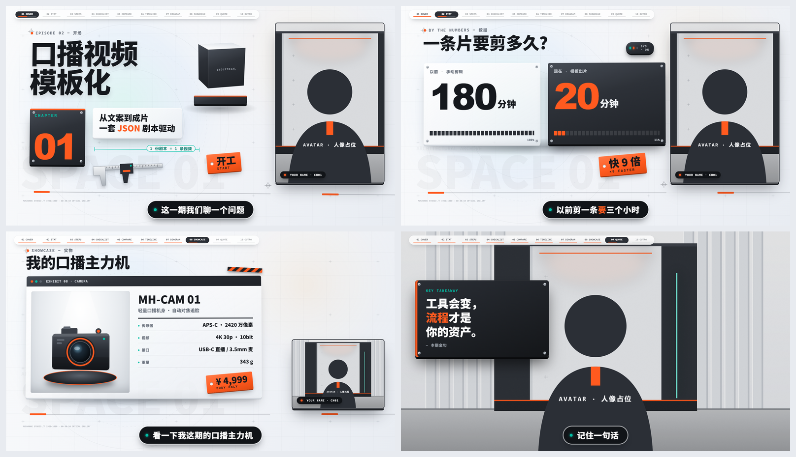
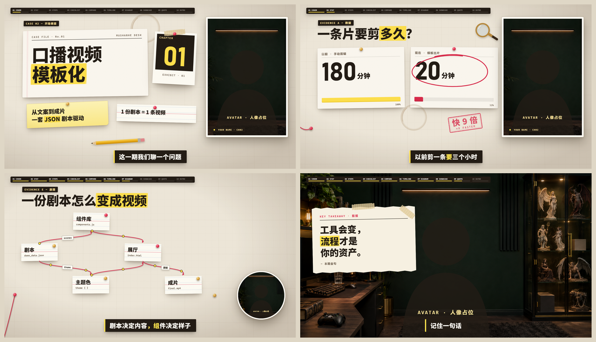
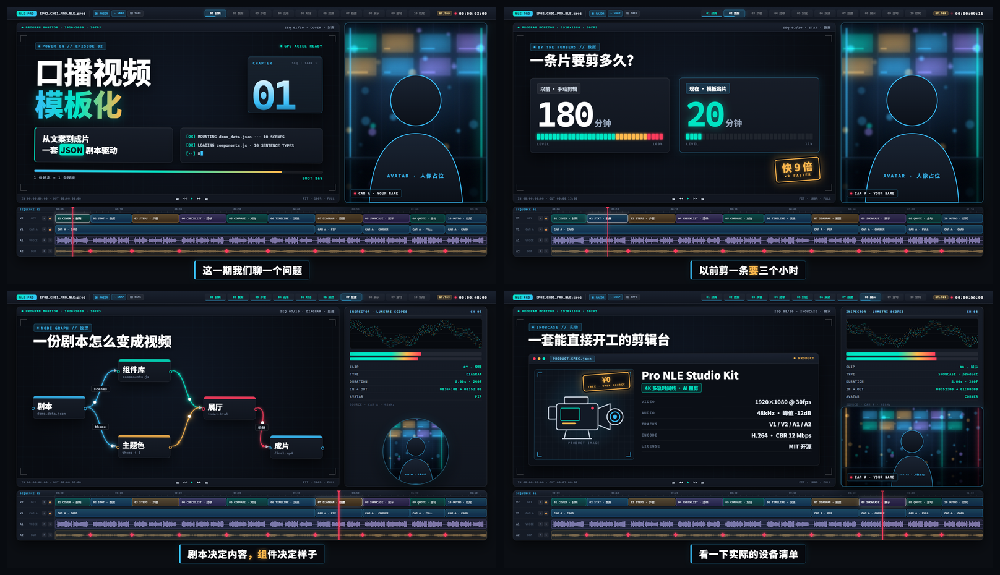

<div align="center">

### [🚀 在线预览 Demo（6 大风格免下载直达）](https://mushanhe.github.io/Mushanhe_Video_Engine/)

# Mushanhe Video Engine

**一份 JSON 剧本，驱动 6 套电影级口播画风。**

1 套 `core/` 通用内核 · 10 大万能口播句型 · 4 种动态人像粒子变形 · **6 套旗舰风格包**

`v2.0` · 纯 HTML / CSS / JS · 零构建 · 任意时间点可 seek 还原

| 01 · 3D 工业实体画廊 | 02 · 瑞士印刷拼贴 |
|---|---|
| <a href="https://mushanhe.github.io/Mushanhe_Video_Engine/templates/01_industrial_3d/index.html"></a><br />[▶ 在线打开 01 展厅](https://mushanhe.github.io/Mushanhe_Video_Engine/templates/01_industrial_3d/index.html) | <a href="https://mushanhe.github.io/Mushanhe_Video_Engine/templates/02_swiss_print/index.html"></a><br />[▶ 在线打开 02 展厅](https://mushanhe.github.io/Mushanhe_Video_Engine/templates/02_swiss_print/index.html) |

| 03 · Vox 侦探桌面 | 04 · ComfyUI 3D 节点图 |
|---|---|
| <a href="https://mushanhe.github.io/Mushanhe_Video_Engine/templates/03_vox_desk/index.html"></a><br />[▶ 在线打开 03 展厅](https://mushanhe.github.io/Mushanhe_Video_Engine/templates/03_vox_desk/index.html) | <a href="https://mushanhe.github.io/Mushanhe_Video_Engine/templates/04_nodegraph/index.html"></a><br />[▶ 在线打开 04 展厅](https://mushanhe.github.io/Mushanhe_Video_Engine/templates/04_nodegraph/index.html) |

| 05 · Pro NLE 多轨剪辑台 | 06 · Neo-Brutalism 撞色潮刊 |
|---|---|
| <a href="https://mushanhe.github.io/Mushanhe_Video_Engine/templates/05_pro_nle/index.html"></a><br />[▶ 在线打开 05 展厅](https://mushanhe.github.io/Mushanhe_Video_Engine/templates/05_pro_nle/index.html) | <a href="https://mushanhe.github.io/Mushanhe_Video_Engine/templates/06_neobrutalism/index.html"></a><br />[▶ 在线打开 06 展厅](https://mushanhe.github.io/Mushanhe_Video_Engine/templates/06_neobrutalism/index.html) |

</div>

---

## 它是什么

Mushanhe Video Engine 把口播视频拆成两层：

- **内容**：写在一份 `{ meta, theme, scenes }` JSON 剧本里，只描述「这一段说什么、用哪种句型」。
- **样子**：交给风格包。同一份剧本换一个风格包，画面就整体换一套美术，文案一个字不用改。

所有画面都按时间确定性渲染：拖到第 37.4 秒，画面就一定是第 37.4 秒该有的样子。所以可以逐帧抽查，也可以无头录制成片。

## 亮点

| | |
|---|---|
| 🧱 **通用内核 `core/`** | 6 自由度 3D 摄影机（推拉摇移 + 手持感）、词级逐字高亮字幕、人像形态控制器、点阵粒子散聚转场、无头抽帧验货脚本 |
| 📜 **统一剧本标准** | `{ meta, theme, scenes }` 一种格式通吃全部 6 套风格包；`theme` 只改配色变量，`scenes[].data` 只放文案 |
| 🗂 **10 大万能句型** | 覆盖知识 / 科技 / 数码 / 工具类口播里最常见的段落类型 |
| 🧑 **4 种人像形态** | `card` 侧栏画框 · `pip` 圆形/方形画中画 · `corner` 角落小窗 · `full` 全屏出镜，形态切换自带粒子散聚转场 |
| 🎨 **6 套旗舰风格包** | 3D 工业实体画廊 · 瑞士印刷拼贴 · Vox 侦探桌面 · ComfyUI 3D 节点图 · Pro NLE 多轨剪辑台 · Neo-Brutalism 撞色潮刊 |

### 10 大万能口播句型

| 句型 | 适用口播 |
|---|---|
| `cover` 封面 | 开场标题、章节号 |
| `stat` 大数字 | 「从 3 小时降到 20 分钟」这类数字钩子，数字滚动 + 比例条 |
| `steps` 步骤 | 3–5 步操作流程 |
| `checklist` 清单 | 规则 / 要点逐条打勾 |
| `compare` 对比 | 错误做法 vs 正确做法 |
| `timeline` 时间轴 | 版本演进、发展阶段，「你在这」高亮；节点多时镜头横向跟拍 |
| `diagram` 关系图 | 原理 / 架构 / 工作流，节点 + 连线 + 流动脉冲 |
| `showcase` 展示 | 代码、终端、文档、截图、录屏，以及 `kind: "product"` 实物设备 / 工具介绍 |
| `quote` 金句 | 全屏人像 + 侧边金句卡，自动避开人脸 |
| `outro` 结尾 | 行动建议 + 关注 / 开源地址 CTA |

### 6 套旗舰风格包

| 风格包 | 美术关键词 | 在线体验 |
|---|---|---|
| [`templates/01_industrial_3d/`](templates/01_industrial_3d/) | 珍珠白光学画廊 · 拉丝金属厚板 · 磨砂玻璃厚边 · 3D 立方体 / 游标卡尺 / 聚光相机展柜 · 画廊漫游玻璃隔断转场 | [▶ 01 展厅](https://mushanhe.github.io/Mushanhe_Video_Engine/templates/01_industrial_3d/index.html) |
| [`templates/02_swiss_print/`](templates/02_swiss_print/) | 米白网格纸 · 瑞士红 · 油墨黑 · 直角纸片与轻投影 · 木尺 / 铅笔 / 三角板实物道具 · 整页抽纸转场 | [▶ 02 展厅](https://mushanhe.github.io/Mushanhe_Video_Engine/templates/02_swiss_print/index.html) |
| [`templates/03_vox_desk/`](templates/03_vox_desk/) | 暖亚麻切割垫 · 荧光黄马克笔 · 红笔手绘圈勾叉 · 红色调查丝线 · 撕边剪报 · 高空俯拍斜飞转场 | [▶ 03 展厅](https://mushanhe.github.io/Mushanhe_Video_Engine/templates/03_vox_desk/index.html) |
| [`templates/04_nodegraph/`](templates/04_nodegraph/) | 深空蓝黑网格 · 发光贝塞尔信号线与脉冲光点 · 示波器 / 环形通过率表 / 激光线框展柜 · 霓虹光幕转场 | [▶ 04 展厅](https://mushanhe.github.io/Mushanhe_Video_Engine/templates/04_nodegraph/index.html) |
| [`templates/05_pro_nle/`](templates/05_pro_nle/) | 未来非编多轨剪辑台 · 真 4 轨时间线与逐字波形 · 右侧 Lumetri 示波器智能补位 · 四色色条场记转场 | [▶ 05 展厅](https://mushanhe.github.io/Mushanhe_Video_Engine/templates/05_pro_nle/index.html) |
| [`templates/06_neobrutalism/`](templates/06_neobrutalism/) | 暖米色呼吸波点 · 4px 粗黑边 · 8 / 12px 硬投影 · 明黄 / 电光蓝 / 薄荷绿 / 珊瑚红撞色 · 四色色块横扫转场 | [▶ 06 展厅](https://mushanhe.github.io/Mushanhe_Video_Engine/templates/06_neobrutalism/index.html) |

## 3 步本地预览

不想下载？直接打开 [在线 Demo](https://mushanhe.github.io/Mushanhe_Video_Engine/)。想本地改剧本，需要 Python 3.8+，无需安装任何依赖：

```bash
# 1. 克隆仓库
git clone https://github.com/mushanhe/Mushanhe_Video_Engine.git
cd Mushanhe_Video_Engine

# 2. 启动本地预览服务（默认 127.0.0.1:8765，支持 HTTP 206 断点续传）
python core/tools/serve.py

# 3. 浏览器打开导航页，点进任意一套风格包展厅
#    http://127.0.0.1:8765/
```

展厅快捷键：`空格` 播放 / 暂停 · `1`–`9` / `0` 跳到第 1–10 段 · `H` 隐藏控制栏。

> 剧本 JSON 通过 `fetch` 加载，请用上面的本地服务打开，直接双击 HTML 会提示加载失败。

## 写你自己的剧本

复制任意风格包里的 `demo_data.json`，改完用 `?data=` 参数加载：

```
http://127.0.0.1:8765/templates/05_pro_nle/index.html?data=my_script.json
```

剧本结构（节选）：

```json
{
  "meta":  { "title": "我的第一条片", "avatar": { "video": "", "bg": "assets/studio_bg.png", "tag": "YOUR NAME" } },
  "theme": { "yellow": "#FFE500", "coral": "#FF4D6D" },
  "scenes": [
    { "type": "cover", "dur": 6, "avatar": "card",
      "sub": ["这一期我们聊一个问题"],
      "data": { "kicker": "EPISODE 01", "title": "口播视频\n模板化", "subtitle": "一套 **JSON** 剧本驱动" } },
    { "type": "stat", "dur": 7, "avatar": "pip",
      "sub": ["以前剪一条要三个小时"],
      "data": { "title": "一条片要剪多久？",
        "items": [ { "value": 180, "unit": "分钟", "label": "以前", "bar": 1 },
                   { "value": 20,  "unit": "分钟", "label": "现在", "bar": 0.11 } ],
        "delta": "快 9 倍" } }
  ]
}
```

- `sub[]`：这一段的字幕行，会自动铺成逐字高亮。
- `avatar`：`card` / `pip` / `corner` / `full`。
- `**关键词**`：在标题、副标题里标出高亮色。
- `meta.avatar.video`：填入你的抠像视频路径，就会替换剪影占位。

每种句型的完整字段，直接看任意风格包里的 `demo_data.json`，10 段全部都有示例。

## 无头抽帧验货

改完画面后，在任意时间点截图自查（需要 `pip install playwright` 并 `playwright install chromium`）：

```bash
python core/tools/inspect_frames.py --template 01_industrial_3d --times 3,9.5,17,25,32.5,40,48,56,63,69.5 --out preview_frames
```

输出 `ZERO_ERRORS` 表示页面无报错，截图在 `preview_frames/`。

## 目录结构

```text
Mushanhe_Video_Engine/
├── index.html                 # 导航页：一键进入 6 套风格包展厅
├── docs/                      # 6 套风格包 2×2 预览拼图
├── core/                      # 通用内核（所有风格包共享）
│   ├── camera-rig.js          # 6 自由度 3D 空间摄影机
│   ├── avatar.js              # 人像形态控制器
│   ├── avatar-morph-fx.js     # 点阵粒子散聚转场
│   ├── subtitle.js            # 词级逐字高亮字幕
│   ├── timeline.js            # 词级时间轴
│   ├── engine.css             # 1920×1080 画幅、图层、HUD
│   ├── …                      # 3D 模块、画廊背景、前景特效、活体光标、拟音等扩展模块
│   ├── vendor/                # 第三方库：GSAP、CustomEase、three.js
│   └── tools/                 # serve.py 预览服务 · inspect_frames.py 抽帧验货
└── templates/
    ├── 01_industrial_3d/      # 旗舰包 #1 · 3D 工业实体画廊
    ├── 02_swiss_print/        # 旗舰包 #2 · 瑞士印刷拼贴
    ├── 03_vox_desk/           # 旗舰包 #3 · Vox 侦探桌面
    ├── 04_nodegraph/          # 旗舰包 #4 · ComfyUI 3D 节点图
    ├── 05_pro_nle/            # 旗舰包 #5 · Pro NLE 多轨剪辑台
    └── 06_neobrutalism/       # 旗舰包 #6 · Neo-Brutalism 撞色潮刊
        ├── components.js      # 10 大句型组件
        ├── demo_data.json     # 10 段示例剧本
        ├── index.html         # 展厅 / 渲染宿主
        └── assets/            # 演播室背景
```

## 做一套新的风格包

在 `templates/` 下新建文件夹，实现同样的 10 个句型，每个组件遵守同一个签名：

```js
create(data, { dur }) → { el, layer, avatar, cams, update(localT), w? }
```

- `el`：组件根节点；`layer`：`world`（跟随 3D 摄影机）或 `screen`（贴在屏幕上）。
- `cams`：本段的机位关键帧；`update(localT)`：按本段时间渲染，必须是确定性的。
- 数据字段与现有 6 套旗舰包保持一致，这样任何一份剧本都能在所有风格包之间无缝切换。

## Roadmap

- [x] **v1.0**：通用内核 `core/` + 10 大句型 + 4 种人像粒子变形 + 2 套旗舰包上线
- [x] **v2.0**：6 大旗舰风格矩阵全部开源上线（工业 3D / 瑞士印刷 / Vox 侦探 / ComfyUI 节点 / Pro NLE / 撞色潮刊）
- [ ] **主题与子模板裂变**：每套旗舰包内置多套 `theme` 配色预设 + `variant` 布局变体 + 垂类组件（财经 / 编程 / 读书）
- [ ] `export_mp4.py`：无头浏览器一键导出 MP4，自带人声响度与 BGM 闪避
- [ ] 剧本可视化编辑器

👉 欢迎到 [Issues](https://github.com/mushanhe/Mushanhe_Video_Engine/issues) 提出你想要的新风格或新句型！

## 第三方组件

`core/vendor/` 内置以下第三方库，保证国内网络环境下离线开箱即用。它们的版权归各自作者，**不受本仓库 MIT 许可覆盖**，请遵守各自许可：

- [GSAP](https://gsap.com) 与 CustomEase（GreenSock）：[GSAP Standard License](https://gsap.com/standard-license)，免费、可商用，但不是开源许可
- [three.js](https://threejs.org)：MIT License

## License

本仓库原创代码与素材（`core/`、`templates/01_industrial_3d/` ~ `templates/06_neobrutalism/`，含演播室背景图 `studio_bg.png`）以 [MIT License](LICENSE) 发布，© 2026 mushanhe。`core/vendor/` 中的第三方库除外，见上节。
