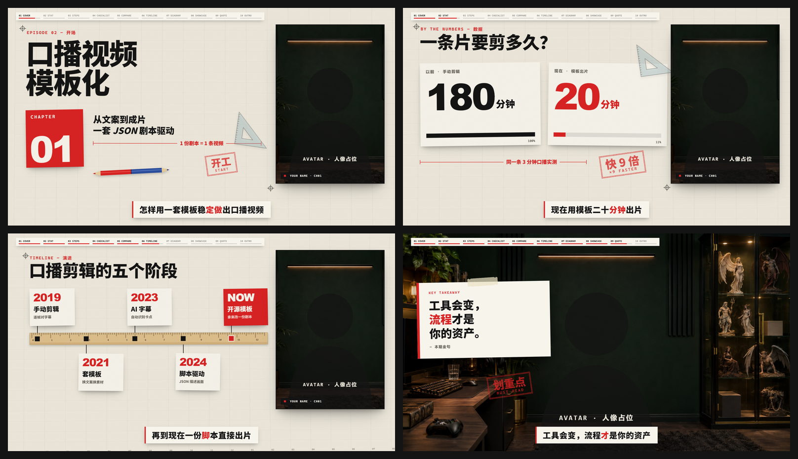
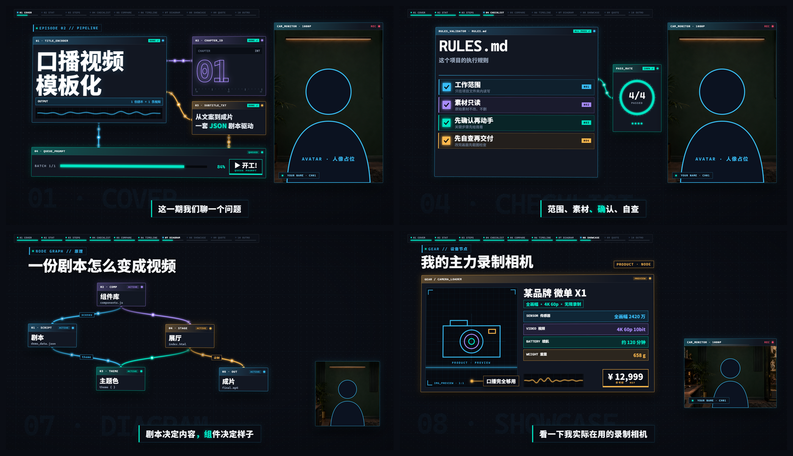
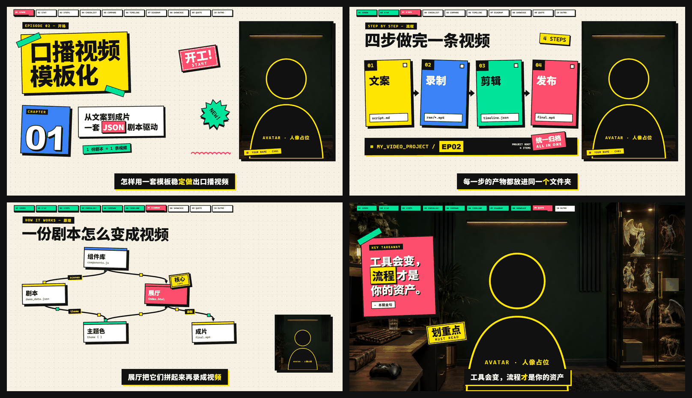
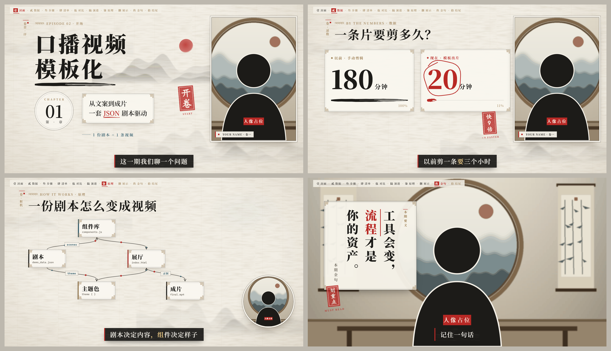
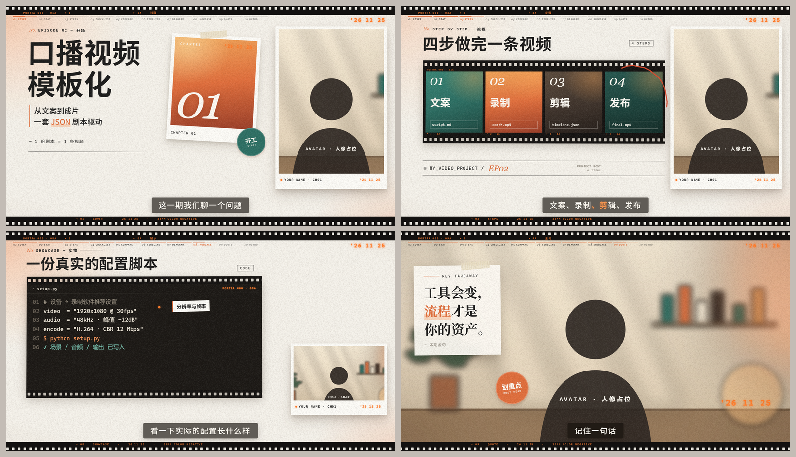
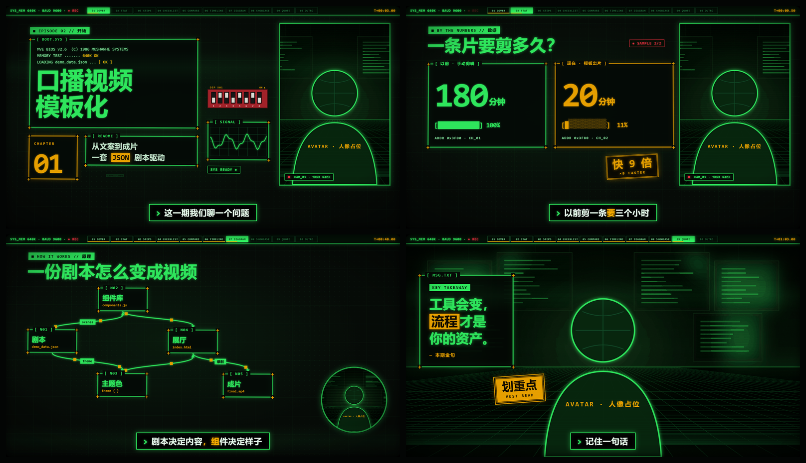
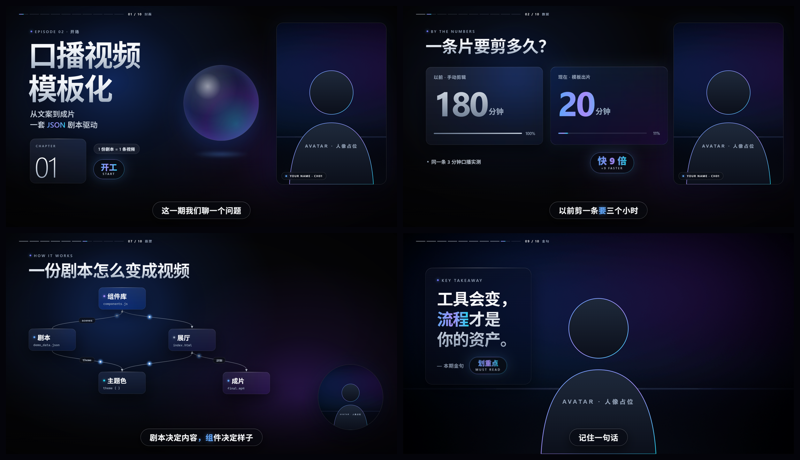
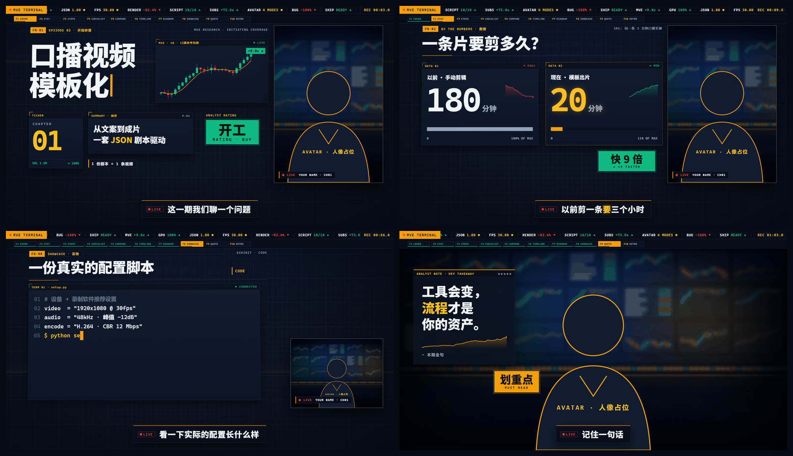

<div align="center">

### [🚀 在线预览 Demo（12 大流派免下载直达）](https://mushanhe.github.io/Mushanhe_Video_Engine/)

# Mushanhe Video Engine

**简体中文** | [English](README.en.md)

**一份 JSON 剧本，驱动 12 大电影级流派 × 30 套开箱皮肤。**

1 套 `core/` 通用内核 · 10 大万能口播句型 · 4 种动态人像粒子变形 · **01–06 各 4 色实时换肤（24 套）+ 07–12 六大新流派**

`v3.3.1` · 纯 HTML / CSS / JS · 零构建 · 任意时间点可 seek 还原 · 右上角 01–12 一键切风格 · 一键导出 1080p / 4K MP4 · 自带中英双语 AI Agent Skill（`SKILL.md` / `SKILL.en.md`）

| 01 · 3D 工业实体画廊 | 02 · 瑞士印刷拼贴 |
|---|---|
| <a href="https://mushanhe.github.io/Mushanhe_Video_Engine/templates/01_industrial_3d/index.html"></a><br />[▶ 在线打开 01 展厅](https://mushanhe.github.io/Mushanhe_Video_Engine/templates/01_industrial_3d/index.html) | <a href="https://mushanhe.github.io/Mushanhe_Video_Engine/templates/02_swiss_print/index.html"></a><br />[▶ 在线打开 02 展厅](https://mushanhe.github.io/Mushanhe_Video_Engine/templates/02_swiss_print/index.html) |

| 03 · 深度调查桌面 | 04 · 3D 节点工作流 |
|---|---|
| <a href="https://mushanhe.github.io/Mushanhe_Video_Engine/templates/03_investigative_desk/index.html"></a><br />[▶ 在线打开 03 展厅](https://mushanhe.github.io/Mushanhe_Video_Engine/templates/03_investigative_desk/index.html) | <a href="https://mushanhe.github.io/Mushanhe_Video_Engine/templates/04_nodegraph/index.html"></a><br />[▶ 在线打开 04 展厅](https://mushanhe.github.io/Mushanhe_Video_Engine/templates/04_nodegraph/index.html) |

| 05 · Pro NLE 多轨剪辑台 | 06 · Neo-Brutalism 撞色潮刊 |
|---|---|
| <a href="https://mushanhe.github.io/Mushanhe_Video_Engine/templates/05_pro_nle/index.html"></a><br />[▶ 在线打开 05 展厅](https://mushanhe.github.io/Mushanhe_Video_Engine/templates/05_pro_nle/index.html) | <a href="https://mushanhe.github.io/Mushanhe_Video_Engine/templates/06_neobrutalism/index.html"></a><br />[▶ 在线打开 06 展厅](https://mushanhe.github.io/Mushanhe_Video_Engine/templates/06_neobrutalism/index.html) |

| 07 · 学院黑板 · 粉笔手绘 | 08 · 宋韵水墨 · 新中式 |
|---|---|
| <a href="https://mushanhe.github.io/Mushanhe_Video_Engine/templates/07_chalkboard/index.html"></a><br />[▶ 在线打开 07 展厅 🆕](https://mushanhe.github.io/Mushanhe_Video_Engine/templates/07_chalkboard/index.html) | <a href="https://mushanhe.github.io/Mushanhe_Video_Engine/templates/08_song_ink/index.html"></a><br />[▶ 在线打开 08 展厅 🆕](https://mushanhe.github.io/Mushanhe_Video_Engine/templates/08_song_ink/index.html) |

| 09 · 日系胶片 · 独立杂志 | 10 · 复古 CRT 像素终端 |
|---|---|
| <a href="https://mushanhe.github.io/Mushanhe_Video_Engine/templates/09_analog_film/index.html"></a><br />[▶ 在线打开 09 展厅 🆕](https://mushanhe.github.io/Mushanhe_Video_Engine/templates/09_analog_film/index.html) | <a href="https://mushanhe.github.io/Mushanhe_Video_Engine/templates/10_retro_crt/index.html"></a><br />[▶ 在线打开 10 展厅 🆕](https://mushanhe.github.io/Mushanhe_Video_Engine/templates/10_retro_crt/index.html) |

| 11 · 发布会流光玻璃 | 12 · 金融数据终端 |
|---|---|
| <a href="https://mushanhe.github.io/Mushanhe_Video_Engine/templates/11_stage_glass/index.html"></a><br />[▶ 在线打开 11 展厅 🆕](https://mushanhe.github.io/Mushanhe_Video_Engine/templates/11_stage_glass/index.html) | <a href="https://mushanhe.github.io/Mushanhe_Video_Engine/templates/12_fin_terminal/index.html"></a><br />[▶ 在线打开 12 展厅 🆕](https://mushanhe.github.io/Mushanhe_Video_Engine/templates/12_fin_terminal/index.html) |

</div>

---

## 它是什么

Mushanhe Video Engine 把口播视频拆成两层：

- **内容**：写在一份 `{ meta, theme, scenes }` JSON 剧本里，只描述「这一段说什么、用哪种句型」。
- **样子**：交给风格包。同一份剧本换一个风格包，画面就整体换一套美术，文案一个字不用改。

所有画面都按时间确定性渲染：拖到第 37.4 秒，画面就一定是第 37.4 秒该有的样子。所以可以逐帧抽查，也可以无头录制成片。

## 亮点

| | |
|---|---|
| 🧱 **通用内核 `core/`** | 6 自由度 3D 摄影机（推拉摇移 + 手持感）、词级逐字高亮字幕、人像形态控制器、点阵粒子散聚转场、无头抽帧验货脚本 |
| 📜 **统一剧本标准** | `{ meta, theme, scenes }` 一种格式通吃全部 12 套风格包；`theme` 只改配色变量，`scenes[].data` 只放文案 |
| 🗂 **10 大万能句型** | 覆盖知识 / 科技 / 数码 / 工具类口播里最常见的段落类型 |
| 🧑 **4 种人像形态** | `card` 侧栏画框 · `pip` 圆形/方形画中画 · `corner` 角落小窗 · `full` 全屏出镜，形态切换自带粒子散聚转场 |
| 🎨 **12 大旗舰流派（v3.0）** | 3D 工业实体画廊 · 瑞士印刷拼贴 · 深度调查桌面 · 3D 节点工作流 · Pro NLE 多轨剪辑台 · Neo-Brutalism 撞色潮刊 · **学院黑板 · 宋韵水墨 · 日系胶片 · 复古 CRT · 发布会流光玻璃 · 金融数据终端** |
| 🌗 **30 套开箱皮肤** | 01–06 每包内置 4 套深浅配色实时皮肤（24 套），展厅右上角胶囊一点即换、`?theme=` 或剧本 `theme.preset` 也能指定；07–12 各自 1 套独立流派美术（6 套） |
| 🎛 **01–12 一键切风格（v3.2）** | 12 套展厅右上角都有「🎨 切换风格」胶囊：鼠标一点跳到任意流派，**自动携带当前 `?data=` 剧本**（路径自动换算）和当前播放时间；按 `H` 同步隐藏，抽帧 / 导出时不出现 |
| 🎬 **一键导出 MP4（v3.2）** | `core/tools/export_mp4.py`：无头浏览器逐帧确定性截图 → FFmpeg 多进程分块编码，1080p / 4K（2 倍矢量渲染）、BT.709 色彩、人声 / 背景乐混流 |
| 🎙 **真实词级时间轴（v3.2）** | 剧本可选 `sc.words` 词级时间戳（字幕按真实语速逐字点亮）、`sc.avatarCues` 段内切人像、`meta.audio` 人声音轨做主时钟、`meta.themeCues` 按时间换肤；不写这些字段时画面与旧版逐帧一致 |
| 🗣 **口播一键对齐（v3.3）** | `core/tools/align.py`：录音 / 录像 → 同源逐字 `words` + 字幕 `sub`，或直接回填草稿剧本的每段时长与 `meta.audio`；faster-whisper 本地识别，不需要 PyTorch |
| 🤖 **AI Agent Skill** | 根目录 `SKILL.md`（English：`SKILL.en.md`）：Claude Code / Antigravity / Cursor 读完就会在 12 套里推荐最对味的风格、写剧本、抽帧验货、交付预览 |

### 10 大万能口播句型

| 句型 | 适用口播 |
|---|---|
| `cover` 封面 | 开场标题、章节号 |
| `stat` 大数字 | 「从 3 小时降到 20 分钟」这类数字钩子，数字滚动 + 比例条 |
| `steps` 步骤 | 3–5 步操作流程 |
| `checklist` 清单 | 规则 / 要点逐条打勾 |
| `compare` 对比 | 错误做法 vs 正确做法 |
| `timeline` 时间轴 | 版本演进、发展阶段，「你在这」高亮；节点多时镜头横向跟拍 |
| `diagram` 关系图 | 原理 / 架构 / 工作流，节点 + 连线 + 流动脉冲 |
| `showcase` 展示 | 代码、终端、文档、截图、录屏，以及 `kind: "product"` 实物设备 / 工具介绍 |
| `quote` 金句 | 全屏人像 + 侧边金句卡：卡片默认贴左（`"pos": "right"` 贴右），约占画面一侧 40% 宽；引擎不识别人脸，拍摄时请让人脸落在另一侧 60% 区域（默认即画面居中或偏右） |
| `outro` 结尾 | 行动建议 + 关注 / 开源地址 CTA |

### 12 大旗舰风格包

| 风格包 | 美术关键词 | 在线体验 |
|---|---|---|
| [`templates/01_industrial_3d/`](templates/01_industrial_3d/) | 珍珠白光学画廊 · 拉丝金属厚板 · 磨砂玻璃厚边 · 3D 立方体 / 游标卡尺 / 聚光相机展柜 · 画廊漫游玻璃隔断转场 | [▶ 01 展厅](https://mushanhe.github.io/Mushanhe_Video_Engine/templates/01_industrial_3d/index.html) |
| [`templates/02_swiss_print/`](templates/02_swiss_print/) | 米白网格纸 · 瑞士红 · 油墨黑 · 直角纸片与轻投影 · 木尺 / 铅笔 / 三角板实物道具 · 整页抽纸转场 | [▶ 02 展厅](https://mushanhe.github.io/Mushanhe_Video_Engine/templates/02_swiss_print/index.html) |
| [`templates/03_investigative_desk/`](templates/03_investigative_desk/) | 暖亚麻切割垫 · 荧光黄马克笔 · 红笔手绘圈勾叉 · 红色调查丝线 · 撕边剪报 · 高空俯拍斜飞转场 | [▶ 03 展厅](https://mushanhe.github.io/Mushanhe_Video_Engine/templates/03_investigative_desk/index.html) |
| [`templates/04_nodegraph/`](templates/04_nodegraph/) | 深空蓝黑网格 · 发光贝塞尔信号线与脉冲光点 · 示波器 / 环形通过率表 / 激光线框展柜 · 霓虹光幕转场 | [▶ 04 展厅](https://mushanhe.github.io/Mushanhe_Video_Engine/templates/04_nodegraph/index.html) |
| [`templates/05_pro_nle/`](templates/05_pro_nle/) | 未来非编多轨剪辑台 · 真 4 轨时间线与逐字波形 · 右侧 视频示波器智能补位 · 四色色条场记转场 | [▶ 05 展厅](https://mushanhe.github.io/Mushanhe_Video_Engine/templates/05_pro_nle/index.html) |
| [`templates/06_neobrutalism/`](templates/06_neobrutalism/) | 暖米色呼吸波点 · 4px 粗黑边 · 8 / 12px 硬投影 · 明黄 / 电光蓝 / 薄荷绿 / 珊瑚红撞色 · 四色色块横扫转场 | [▶ 06 展厅](https://mushanhe.github.io/Mushanhe_Video_Engine/templates/06_neobrutalism/index.html) |
| [`templates/07_chalkboard/`](templates/07_chalkboard/) 🆕 | 深墨绿磨砂黑板 · 粉笔白 / 黄 / 天蓝 / 珊瑚粉 · 种子化手绘抖动边框 · 逐笔描出圈勾箭头 · 原木黑板擦与彩色粉笔头 | [▶ 07 展厅](https://mushanhe.github.io/Mushanhe_Video_Engine/templates/07_chalkboard/index.html) |
| [`templates/08_song_ink/`](templates/08_song_ink/) 🆕 | 宣纸 · 徽墨 · 朱砂 · 石青 · 1px 细墨双框 + 回纹角花 · 朱砂方印 · 毛笔飞白 · 竖排引题 · 月洞窗人像 | [▶ 08 展厅](https://mushanhe.github.io/Mushanhe_Video_Engine/templates/08_song_ink/index.html) |
| [`templates/09_analog_film/`](templates/09_analog_film/) 🆕 | 奶白杂志纸 · 拍立得白边 · 35mm 齿孔胶片条 · 橙色发光日期戳 · 即显相纸显影动画 · 油性记号笔圈注 | [▶ 09 展厅](https://mushanhe.github.io/Mushanhe_Video_Engine/templates/09_analog_film/index.html) |
| [`templates/10_retro_crt/`](templates/10_retro_crt/) 🆕 | 纯黑微绿荧光屏 · 磷光绿发光 + 扫描线 · 双线 ASCII 窗框 · 像素块进度条 · 打字机逐字敲出 · CRT 开窗闪烁 | [▶ 10 展厅](https://mushanhe.github.io/Mushanhe_Video_Engine/templates/10_retro_crt/index.html) |
| [`templates/11_stage_glass/`](templates/11_stage_glass/) 🆕 | 纯黑舞台 · 1px 亮边液态毛玻璃 Bento · 钛金属渐变超大标题 · 蓝紫青极光点睛 · 景深模糊柔和入场 | [▶ 11 展厅](https://mushanhe.github.io/Mushanhe_Video_Engine/templates/11_stage_glass/index.html) |
| [`templates/12_fin_terminal/`](templates/12_fin_terminal/) 🆕 | 深海藏青终端面板 · 琥珀功能键 · 等宽表格数字 · 确定性 K 线 / sparkline · 滚动行情条 · 评级徽章涨绿跌红 | [▶ 12 展厅](https://mushanhe.github.io/Mushanhe_Video_Engine/templates/12_fin_terminal/index.html) |

> **v3.2.2 目录改名**：03 / 11 / 12 三套风格包改为中性名 `03_investigative_desk`（深度调查桌面）· `11_stage_glass`（发布会流光玻璃）· `12_fin_terminal`（金融数据终端），**旧目录网址已失效，请用新地址**（书签、外链、`?data=` 剧本路径一并更新）。
> 05 的皮肤改名为 `studio_dark` / `color_grade` / `light_silver`，旧皮肤名写在 `?theme=`、`theme.preset`、`meta.themeCues` 里仍会自动换成新名。

### 30 套开箱皮肤（v3.0）

**01–06** 每套风格包都有自己的 `themes.js`，内置 4 套皮肤（第一套是默认，不带参数打开时与 v2.0 画面完全一致）。每套皮肤都用无头浏览器抽帧检查过文字、卡片、字幕、人像边框的对比度（暗色皮肤不出现黑字配黑底，浅色皮肤不出现白字配白底）。

| 风格包 | `?theme=` 皮肤 |
|---|---|
| 01 · 3D 工业实体画廊 | `pearl` 珍珠白 · `obsidian` 黑曜石 · `tactical` 战术沙 · `concrete` 混凝土 |
| 02 · 瑞士印刷拼贴 | `classic` 瑞士红 · `bauhaus` 包豪斯 · `midnight` 暗夜版画 · `botanical` 博物森林 |
| 03 · 深度调查桌面 | `linen` 亚麻 · `night_desk` 台灯夜 · `blueprint` 蓝图 · `newsprint` 新闻纸 |
| 04 · 3D 节点工作流 | `cyber` 深空赛博 · `matrix` 黑客矩阵 · `amber_lab` 核能琥珀 · `daylight` 白昼蓝图 |
| 05 · Pro NLE 多轨剪辑台 | `studio_dark` 深蓝黑 · `color_grade` 调色台 · `light_silver` 浅银 · `broadcast` 导播台 |
| 06 · Neo-Brutalism 撞色潮刊 | `zine` 潮刊 · `acid` 酸性 · `pop_pink` 波普 · `mono_ink` 漫画 |
| 07–12 · 六大新流派 | 各 1 套独立流派美术（黑板 / 水墨 / 胶片 / CRT / 发布会玻璃 / 金融终端），`theme` 里写颜色变量即可微调 |

01–06 三种换法，优先级从高到低：

1. URL 参数：`templates/02_swiss_print/index.html?theme=midnight`
2. 剧本里写：`"theme": { "preset": "midnight" }`
3. 展厅右上角换肤胶囊，点一下即换并同步 URL；按 `H` 隐藏控制栏时一起隐藏。

`01_industrial_3d` 另有 4 个版式变体，在场景里写 `"variant"` 即可启用：`cover` → `blueprint` · `stat` → `gauge` · `steps` → `conveyor` · `compare` → `split`，示例剧本 `templates/01_industrial_3d/demo_variants.json`。

## 3 步本地预览

不想下载？直接打开 [在线 Demo](https://mushanhe.github.io/Mushanhe_Video_Engine/)。想本地改剧本，需要 Python 3.8+，无需安装任何依赖：

```bash
# 1. 克隆仓库
git clone https://github.com/mushanhe/Mushanhe_Video_Engine.git
cd Mushanhe_Video_Engine

# 2. 启动本地预览服务（默认 127.0.0.1:8765，支持 HTTP 206 断点续传）
python core/tools/serve.py

# 3. 浏览器打开导航页，点进任意一套风格包展厅
#    http://127.0.0.1:8765/
```

展厅快捷键：`空格` 播放 / 暂停 · `1`–`9` / `0` 跳到第 1–10 段 · `H` 隐藏控制栏（右上角切换器同步隐藏）。

想换风格？点展厅右上角「🎨 切换风格 01–12」，在 12 套之间一键跳转；当前用 `?data=` 加载的剧本会自动带过去，例如在 `01_industrial_3d/index.html?data=my_script.json` 切到 02，会打开 `02_swiss_print/index.html?data=../01_industrial_3d/my_script.json`。

> 剧本 JSON 通过 `fetch` 加载，请用上面的本地服务打开，直接双击 HTML 会提示加载失败。

## 写你自己的剧本

复制任意风格包里的 `demo_data.json`，改完用 `?data=` 参数加载：

```
http://127.0.0.1:8765/templates/05_pro_nle/index.html?data=my_script.json
```

剧本结构（节选）：

```json
{
  "meta":  { "title": "我的第一条片", "avatar": { "video": "", "bg": "assets/studio_bg.png", "tag": "YOUR NAME" } },
  "theme": { "yellow": "#FFE500", "coral": "#FF4D6D" },
  "scenes": [
    { "type": "cover", "dur": 6, "avatar": "card",
      "sub": ["这一期我们聊一个问题"],
      "data": { "kicker": "EPISODE 01", "title": "口播视频\n模板化", "subtitle": "一套 **JSON** 剧本驱动" } },
    { "type": "stat", "dur": 7, "avatar": "pip",
      "sub": ["以前剪一条要三个小时"],
      "data": { "title": "一条片要剪多久？",
        "items": [ { "value": 180, "unit": "分钟", "label": "以前", "bar": 1 },
                   { "value": 20,  "unit": "分钟", "label": "现在", "bar": 0.11 } ],
        "delta": "快 9 倍" } }
  ]
}
```

- `sub[]`：这一段的字幕行，会自动铺成逐字高亮。
- `avatar`：`card` / `pip` / `corner` / `full`。
- `**关键词**`：在标题、副标题里标出高亮色。
- `meta.avatar.video`：填入你的抠像视频路径，就会替换剪影占位。
- 画幅固定 1920×1080（`core/engine.css`），导出分辨率和帧率由 `export_mp4.py` 的 `--res` / `--fps` 决定，剧本不控制。

### 真人素材同步字段（v3.2，可选）

时间一律是**全片绝对秒**（从第 1 段开头算起，不是本段相对秒）；不写这些字段时画面与原版逐帧一致。

| 字段 | 格式 | 作用 |
|---|---|---|
| `sc.words` | `[["字", 起始绝对秒, 结束绝对秒], ...]` | 真实词级字幕高亮；不写则回退 `sub[]` 均分。分行按 `sub[]` 逐字比对映射（多念 / 少念 / 改口不串行）。相对秒自动纠正只覆盖一种情况：第 2 段起、首词早于段首 0.5s 以上、且整体加段首后全部落在 `[段首-1s, 段尾+1s]` 内；其余越界词只 `console.warn`（段号 + 词序号），不改时间 |
| `sc.avatarCues` | `[[绝对秒, "card\|pip\|corner\|full"], ...]` | 一段之内切换人像形态 |
| `meta.audio` | `"voice.wav"` 或 `{ "src": "...", "offset": 0, "volume": 1 }` | 人声音轨，播放时作为主时钟 |
| `meta.themeCues` | `[[绝对秒, "obsidian", "角标文字"], ...]` | 按时间实时换肤（01–06） |

> ⚠️ **人像 `<video>` 默认静音**：12 套模板都不会使用出镜视频自带的音轨。请用 `meta.audio` 或导出时 `--audio` 提供人声，否则成片无声。

每种句型的完整字段，直接看任意风格包里的 `demo_data.json`，10 段全部都有示例。

## 真人口播一键对齐（v3.3）

有录音或录像时，不用手写 `sc.words`：`core/tools/align.py` 用 faster-whisper 听写真实口播，产出**同源**的逐字时间 `words` 和字幕行 `sub`（全片绝对秒），字幕切行规则与 `script-sync.js` 完全一致。

```bash
pip install faster-whisper            # 必需（不依赖 PyTorch），另需 PATH 里有 ffmpeg
pip install pypinyin                  # 可选：配合 --script 修正同音错字
pip install opencc-python-reimplemented   # 可选（或 zhconv）：繁转简；没装用内置高频表兜底

# 模式 A：只要逐字时间 → aligned.json（duration / audio / words / sub / corrections）
python core/tools/align.py --input voice.wav --script script.txt --out aligned.json

# 模式 B：把真实口播回填进草稿剧本（每段 start / dur / words / sub + meta.audio），直接能渲染、能导出
python core/tools/align.py --input voice.wav --script script.txt --inject templates/06_neobrutalism/draft.json --out templates/06_neobrutalism/final.json
```

- **输入**：`.wav` `.mp3` `.m4a` `.mp4` `.mkv` `.mov`。视频输入会另存一份 48 kHz 立体声 WAV 作为 `meta.audio`（也可 `--extract-audio` 指定路径）。
- **模型**：默认 `--model medium`；`--model-dir` 或 `HF_HOME` 指定缓存位置，`--offline` 只用本地模型。有 CUDA 自动用 float16，否则（或缺 cuBLAS / cuDNN）自动退回 CPU int8。
- **文稿 `--script`**：提示词只放一句说明 + 文稿里的专有名词（Claude、WorkBuddy、JSON、Skill…），不塞全文；纠错很保守——只改一字对一字的同音错字、数字写法（十二→12）、英文大小写 / 拼写，多念、少念、改口一律以实际念的为准，每处都记进 `corrections`。
- **模式 B 规则**：每段草稿文字取 `sub`（没有再取 `text`、`script`）；段与段首尾衔接无空隙；没有口播的段（片尾、纯画面）保持原时长顺延；长稿（约 2000 字 / 7 分钟以上）自动逐段顺序对齐。结果看最后几行：`STATUS OK` / `STATUS PARTIAL`（有段没回填或差异较大，列出警告清单）/ `STATUS FAIL too-large|mismatch|io`（退出码 1，不写正式输出，只写 `<out>.failed.json` 便于排查）。`meta.audio` 按模板页面目录写相对路径（剧本不在风格包目录时用 `--page-dir` 指定）。
- **`--refine`（可选）**：再用 stable-ts 按最终文字强制对齐，需 `pip install stable-ts`，**会连带安装 PyTorch（约 0.5–2 GB）**；没装就自动跳过并提示。

> ⚠️ **硬约束**：align.py 必须跑在最终用于播放和导出的那条 `meta.audio` 音轨上。后期剪掉停顿、变速或重新拼接后，必须重新跑一次，否则全片时间会整体错位。

**本机实测**（Intel i5-14600KF · CPU int8 · 无 GPU 加速）：

| 模型 | 体积 | 11.8 秒口播 | 3 分 04 秒口播 | 文字一致率¹ | 每字起点误差 中位 / P95¹ |
|---|---|---|---|---|---|
| `medium`（默认） | 1.53 GB | 识别 7–10 s | 识别约 85 s（0.45× 实时） | 99.4% | 20 ms / 140 ms |
| `medium` + `--refine` | 同上 + PyTorch | 全程约 16 s | 全程约 122 s | 99.4% | 17 ms / 130 ms |
| `large-v3-turbo` | 约 1.6 GB | 识别约 5 s | 识别约 44 s（0.24× 实时） | 99.1% | 120 ms / 350 ms |

¹ 以 EP03 正式上线的逐字时间为标准答案（3 分 04 秒那段）；`--script` 纠错 12 处全部改对。turbo 快一倍但逐字时间明显偏晚，不适合逐字高亮，所以默认用 medium。模型首次加载（冷启动）约 50 s，之后约 4 s。

## 作为 AI Agent Skill 使用

仓库根目录的 [`SKILL.md`](SKILL.md)（英文版 [`SKILL.en.md`](SKILL.en.md)）是一份标准 Agent Skill：12 大流派 + 30 套皮肤索引、10 大句型速查、剧本规范、5 步出片流程（含一键导出 MP4）和「开工前更新检查（先问你再更新）」都在里面。把仓库交给 AI 编程助手后，直接说人话就能出片。

**Claude Code**：把 `SKILL.md`（英文环境用 `SKILL.en.md`：复制后改名为 `SKILL.md`，并把中文版 `SKILL.md` 顶部的 frontmatter 粘到最前；`SKILL.en.md` 本身不带 frontmatter，避免两个 Skill 重名）复制到 `~/.claude/skills/mushanhe-video-engine/SKILL.md`（全局）或仓库内 `.claude/skills/mushanhe-video-engine/SKILL.md`，之后说到做口播视频时会自动调用；临时用也可以在对话里说“先读根目录 SKILL.md”。

**Antigravity / Cursor**：打开仓库文件夹，在对话里说“先读根目录 SKILL.md，再按里面的流程做”，或把它加到项目规则 / Rules 里。

然后直接说，例如：

> 把下面这段口播稿做成视频，科技评测题材，用工业 3D 的黑曜石皮肤。
>
> 这段稿子讲 AI 工作流，帮我推荐一个风格和皮肤，做完给我预览链接。
>
> 刚才那条换成瑞士印刷的包豪斯皮肤再出一版。
>
> 这是一期讲宋词的读书视频，你挑一个最对味的风格。

AI 会按 5 步走：① 确认或推荐风格与皮肤 → ② 把口播稿写成 `{ meta, theme, scenes }` 剧本 → ③ 跑 `inspect_frames.py` 抽帧，确认 `ZERO_ERRORS` 并逐张检查 → ④ 启动 `serve.py` 交付预览链接 → ⑤ 确认后用 `export_mp4.py` 导出成片。同一份剧本随时可以换成其他 11 套风格，01–06 还能换另外 3 套皮肤。

## 无头抽帧验货

改完画面后，在任意时间点截图自查（需要 `pip install playwright` 并 `playwright install chromium`）：

```bash
python core/tools/inspect_frames.py --template 01_industrial_3d --times 3,9.5,17,25,32.5,40,48,56,63,69.5 --out preview_frames
```

验非默认皮肤或自己的剧本，加 `--theme` / `--data`（剧本路径相对风格包目录，会自动拼成 `?data=..&theme=..&t=..&clean=1`）：

```bash
python core/tools/inspect_frames.py --template 01_industrial_3d --data demo_variants.json --theme obsidian --times 3,9.5 --out scratch_verify/my_ep
```

输出 `ZERO_ERRORS` 表示页面无报错，截图在 `--out` 指定的目录。

## 一键导出 MP4（1080p / 4K）

依赖：`pip install playwright`（本机装了 Edge / Chrome 就直接用，否则再 `playwright install chromium`）+ PATH 里有 [FFmpeg](https://ffmpeg.org/download.html)。

```bash
# 单模板默认展厅（时长自动读取剧本总长）
python core/tools/export_mp4.py --template 01_industrial_3d --theme obsidian --out output/demo_obsidian.mp4

# 自己的剧本 + 人声音轨（剧本里写了 meta.audio 时可省略 --audio）
python core/tools/export_mp4.py --template 05_pro_nle --data my_script.json --theme color_grade --audio my_voice.wav --out output/my_ep.mp4

# 4K：同一 1920×1080 版式按 2 倍设备像素矢量渲染成 3840×2160，零坐标偏移
python core/tools/export_mp4.py --template 08_song_ink --data my_script.json --res 4k --out output/my_ep_4k.mp4
```

| 参数 | 说明 |
|---|---|
| `--template` / `--file` / `--url-path` / `--data` / `--theme` | 与 `inspect_frames.py` 相同的页面入口，自动带 `clean=1`（不出现控制栏和切换器） |
| `--res 1080p\|4k` · `--fps 30` | 输出 1920×1080 或 3840×2160，H.264 High · yuv420p · BT.709 |
| `--start` / `--duration` | 只导出一段（冒烟测试很好用）；不填时长则读页面 `__MH_ENGINE__.duration` |
| `--workers 4` · `--crf` · `--preset` | 多进程分块并行；CRF 默认 1080p = 18、4K = 16 |
| `--audio` · `--bgm` · `--bgm-vol 0.10` | 外部人声 / 母带精准混流（默认用剧本 `meta.audio`），可选循环背景乐；AAC 48 kHz 320 kbps |

**预期耗时**：本地无头逐帧渲染，1080p 约为实时时长的 3–10×（取决于机器与素材），4K 更久。启动时会先打印总帧数、workers 数与预估分钟数，之后每 5s 输出进度与 ETA。建议先加 `--duration 3` 冒烟确认画面和声音，再导全片。

原理：每帧 `seek(t)` → 等人像视频解码就绪 → 等 2 帧 `requestAnimationFrame` 落帧 → PNG 截图直接管道喂给 FFmpeg（不落盘），最后无损拼接分块并混流音频。结尾输出 `ZERO_ERRORS` 表示全程无页面报错。

## 获取后续新风格与更新

新流派、新皮肤和工具都会持续更新到 `main`。在仓库根目录：

```bash
python core/tools/check_update.py --force    # 自动识别当前分支的上游；STATUS BEHIND N 会列出更新摘要
git pull --ff-only                           # 确认要更新再执行：只快进，不合并、不覆盖你的本地文件
```

你自己的剧本建议另存为新文件（如 `my_script.json`），更新时不会被覆盖；如果改过仓库里的原文件导致 pull 失败，先手动 `git stash` 再更新（不要用 `git reset`）。
用 AI 编程助手时，`SKILL.md` 第 0 步会在开工时静默检查（一天最多一次、5 秒超时），发现新版先问你，你同意才 `git pull --ff-only`，从不自动更新。

> **从 v3.2.1 及更早版本升级**：用 `git pull` 升级时，v3.2.2 改名的旧目录（`03_vox_desk`、`11_keynote_glass`、`12_bloomberg_fin`）会被自动删除；只有旧目录里放了你自己的文件时才会残留，残留的请把自己的文件挪走后删掉旧目录（`check_update.py` 发现时会多打一行提示，只提示不删除）。
> 用下载压缩包覆盖升级的，**必须先删掉这 3 个旧目录**，否则本地会同时出现新旧 15 套模板。

## 目录结构

```text
Mushanhe_Video_Engine/
├── index.html                 # 导航页：12 张流派海报卡 · 01–06 皮肤色点直达
├── README.en.md               # English README
├── SKILL.md                   # AI Agent Skill：选风格 → 写剧本 → 验货 → 交付
├── SKILL.en.md                # AI Agent Skill（English）
├── docs/                      # 12 套风格包 2×2 预览拼图（1616×930）
├── core/                      # 通用内核（所有风格包共享）
│   ├── camera-rig.js          # 6 自由度 3D 空间摄影机
│   ├── avatar.js              # 人像形态控制器
│   ├── avatar-morph-fx.js     # 点阵粒子散聚转场
│   ├── subtitle.js            # 词级逐字高亮字幕
│   ├── timeline.js            # 词级时间轴
│   ├── script-sync.js         # 真实词级字幕 / 人声主时钟 / 按时换肤 · 右上角 01–12 风格切换器
│   ├── engine.css             # 1920×1080 画幅、图层、HUD
│   ├── …                      # 3D 模块、画廊背景、前景特效、活体光标、拟音等扩展模块
│   ├── vendor/                # 第三方库：GSAP、CustomEase、three.js
│   └── tools/                 # serve.py 预览服务 · inspect_frames.py 抽帧验货 · smoke_test.py 12 套冒烟回归 · align.py 口播对齐 · export_mp4.py 一键导出 MP4 · check_update.py 更新检查
└── templates/
    ├── 01_industrial_3d/      # 旗舰包 #1 · 3D 工业实体画廊
    ├── 02_swiss_print/        # 旗舰包 #2 · 瑞士印刷拼贴
    ├── 03_investigative_desk/           # 旗舰包 #3 · 深度调查桌面
    ├── 04_nodegraph/          # 旗舰包 #4 · 3D 节点工作流
    ├── 05_pro_nle/            # 旗舰包 #5 · Pro NLE 多轨剪辑台
    ├── 06_neobrutalism/       # 旗舰包 #6 · Neo-Brutalism 撞色潮刊
    ├── 07_chalkboard/         # 旗舰包 #7 · 学院黑板粉笔手绘（v3.0）
    ├── 08_song_ink/           # 旗舰包 #8 · 宋韵水墨新中式（v3.0）
    ├── 09_analog_film/        # 旗舰包 #9 · 日系胶片独立杂志（v3.0）
    ├── 10_retro_crt/          # 旗舰包 #10 · 复古 CRT 像素终端（v3.0）
    ├── 11_stage_glass/      # 旗舰包 #11 · 发布会流光玻璃（v3.0）
    └── 12_fin_terminal/      # 旗舰包 #12 · 金融数据终端（v3.0）
        ├── components.js      # 10 大句型组件
        ├── themes.js          # 4 套实时皮肤（仅 01–06）
        ├── demo_data.json     # 10 段示例剧本
        ├── index.html         # 展厅 / 渲染宿主
        └── assets/            # 演播室背景
```

## 做一套新的风格包

在 `templates/` 下新建文件夹，实现同样的 10 个句型，每个组件遵守同一个签名：

```js
create(data, { dur }) → { el, layer, avatar, cams, update(localT), w? }
```

- `el`：组件根节点；`layer`：`world`（跟随 3D 摄影机）或 `screen`（贴在屏幕上）。
- `cams`：本段的机位关键帧；`update(localT)`：按本段时间渲染，必须是确定性的。
- 数据字段与现有 12 套旗舰包保持一致，这样任何一份剧本都能在所有风格包之间无缝切换。

## Roadmap

- [x] **v1.0**：通用内核 `core/` + 10 大句型 + 4 种人像粒子变形 + 2 套旗舰包上线
- [x] **v2.0**：6 大旗舰风格矩阵全部开源上线（工业 3D / 瑞士印刷 / 深度调查 / 3D 节点工作流 / Pro NLE / 撞色潮刊）
- [x] **v2.5**：6 套风格包各内置 4 套实时皮肤（共 24 套）+ 01 工业 3D 的 4 个 `variant` 版式变体 + 统一 `SKILL.md` Agent Skill
- [x] **v3.0**：12 大旗舰流派（新增学院黑板 / 宋韵水墨 / 日系胶片 / 复古 CRT / 发布会流光玻璃 / 金融数据终端）+ 30 套开箱皮肤 + 12 张 2×2 预览拼图 + `SKILL.md` 12 套平权索引
- [x] **v3.1**：`inspect_frames.py` 支持 `--data` / `--theme`，一行命令验任意皮肤与自定义剧本；`SKILL.md` 精简，轻量 Agent 也能直接调用
- [x] **v3.2**：`export_mp4.py` 一键导出 1080p / 4K MP4（多进程分块 + BT.709 + 音频混流）· 12 套展厅右上角 01–12 风格切换器（自动携带 `?data=` 剧本）· `script-sync.js` 真实词级字幕 / 人声主时钟 / 按时换肤 · `SKILL.md` 新增导出与自动检查更新
- [x] **v3.2.1**：`sc.words` 误传本段相对秒自动纠正并告警 · `export_mp4.py` 启动时打印耗时预期 · 中英双语 `README` / `SKILL`（`README.en.md` · `SKILL.en.md`）· 补齐 4 个同步字段说明与人像静音提醒
- [x] **v3.2.2**：彻底去商标化（03 / 11 / 12 目录与 05 皮肤改中性名，旧皮肤名自动兼容）· `smoke_test.py` 12 套冒烟 + 逐像素基线回归 · 字幕按 `sub[]` 逐字比对分行（多念 / 少念 / 改口不串行）+ 相对秒越界告警 · `SKILL` 开工前更新检查（先问再更新）与环境自检
- [ ] **07–12 实时皮肤**：六大新流派各补 4 套 `themes.js` 实时皮肤
- [ ] **更多变体与垂类组件**：其余风格包的 `variant` 布局变体 + 垂类组件（财经 / 编程 / 读书）
- [x] **v3.3**：`align.py` 口播对齐（faster-whisper，模式 A 独立输出 / 模式 B 回填剧本，同源 words + sub，文稿保守纠错，可选 `--refine` stable-ts 强制对齐）
- [x] **v3.3.1**：fix：长稿分段对齐（>2000 字不再整片失败）、失败显式报错（`STATUS OK / PARTIAL / FAIL`）、更新检查复用本地结果、升级说明补旧目录清理
- [ ] BGM 自动闪避（人声段自动压低背景乐）
- [ ] 剧本可视化编辑器

👉 欢迎到 [Issues](https://github.com/mushanhe/Mushanhe_Video_Engine/issues) 提出你想要的新风格或新句型！

## 第三方组件

`core/vendor/` 内置以下第三方库，保证国内网络环境下离线开箱即用。它们的版权归各自作者，**不受本仓库 MIT 许可覆盖**，请遵守各自许可：

- [GSAP](https://gsap.com) 与 CustomEase（GreenSock）：[GSAP Standard License](https://gsap.com/standard-license)，免费、可商用，但不是开源许可
- [three.js](https://threejs.org)：MIT License。12 套公开模板本身不加载它；保留 `core/vendor/three.min.js` 是为了 `core/studio-3d.js`（3D 演播室）和 `core/modules-3d.js`（13 套参数化 3D 模块），二者依赖全局 `THREE`，自建风格包要用 3D 模块时直接 `<script>` 引入即可

## License

本仓库原创代码与素材（`core/`、`templates/01_industrial_3d/` ~ `templates/12_fin_terminal/` 全部 12 套风格包，含演播室背景图 `studio_bg.png` 与 `docs/` 预览拼图）以 [MIT License](LICENSE) 发布，© 2026 mushanhe。`core/vendor/` 中的第三方库除外，见上节。

字体说明：模板不内置任何字体文件，只写 CSS 字体栈，保证离线秒开。推荐安装开源字体 **Noto Sans SC / 思源黑体**、**Noto Serif SC / 思源宋体**、**JetBrains Mono**（SIL OFL，可商用），画面与预览图一致；
没装时按字体栈逐级回退到系统字体（Windows：微软雅黑 / 宋体 / Consolas；macOS：苹方 / 宋体-简 / Menlo；Linux：文泉驿 / DejaVu），版式不变、字形略有差异。用于商业发布时，请确保最终用到的系统字体已获商用授权，或安装上述开源字体。
